# Layout browser visual validation — 2026-10-16

## Runtime and scope

- Chromium project, Playwright 1.62.1, integration candidate `39e28a371889379891ec1d8d25e47da95bc36178`.
- The editor loaded the newly generated baseline and SIMD WASM modules from `just wasm-build`; these runs did not log the earlier TypeScript-stub renderer fallback.
- The clean commit at that master tip references `packages/codegen/src/bundle-assets.ts`, which was still untracked in the shared working checkout. For these scratch integration runs only, the untracked `bundle-assets.ts` and `svgTextLayout.ts` sources were copied into the temporary worktree to let Vite compile. They were not added to the feature branch or merge commit.

## Executed workflows

| Command / case | Result | What was inspected |
|---|---|---|
| `node scripts/quality/heavy-lease.mjs "e2e: wrap, fill and undo layout interactions" -- npx playwright test tests/e2e/canvas/autolayout-visual.spec.ts --project=chromium --workers=1 --reporter=list --grep 'wrap enabled\|child fill sizing expands\|undo reverts layout change'` | 3 passed | Wrapped children, Fill width geometry, and one-step undo. |
| `node scripts/quality/heavy-lease.mjs "e2e: layout guides desktop/mobile visual capture" -- npx playwright test tests/e2e/canvas/grid-system.spec.ts --project=chromium --workers=1 --reporter=list` | 2 passed | Independent guide visibility/history; Guide Layouts controls, 390×844 bounds, validation, keyboard focus, Escape cancellation. |
| `node scripts/quality/heavy-lease.mjs "e2e: responsive constraints parent resize" -- npx playwright test tests/e2e/canvas/constraints.spec.ts --project=chromium --workers=1 --reporter=list --grep 'resizing parent frame propagates constraints'` | 1 passed | Stretched child width followed parent resize. |

The screenshots were opened and inspected. The compact dialog remains within 390×844, has two-column margin controls, and preserves reachable Cancel/Apply buttons. The editor view shows visual guides in their own inspector section, separate from the layout solver. Auto-layout screenshots show children wrapping and a Fill child spanning the available row width.

### Follow-up: responsive grid removal preview — 2026-10-18

- Ran `TMPDIR=/home/kevina/.cache/varve-layout-tmp node scripts/quality/heavy-lease.mjs "e2e: grid track removal responsive preview" -- npx playwright test tests/e2e/canvas/grid-system.spec.ts --project=chromium --workers=1 --reporter=list --grep "previews grid track removal"` on `codex/layout-reliability` at `ed1cc260d` plus the uncommitted diagnostic and inspector follow-up. Result: **1 passed**.
- The editor opened the baseline and SIMD WASM artifacts copied into this isolated worktree from the primary checkout; the run output contained no WASM fallback warning. These are generated artifacts and are not tracked by the feature branch.
- The interaction added two tracks, opened the removal preview by keyboard, checked dialog focus, canceled at 390px and verified focus returned to the visible canvas after the inspector hid, then reopened at 1280px and applied removal as one history entry before verifying one undo. It checked dialog bounds and the two-column/one-column preview breakpoint at widths 481, 480, 390, and 1280px.
- Captured frames were inspected at 1280px, 481px, and 390px. The dialog remains inside the viewport, keeps Before/After geometry and both actions visible, and switches to a single preview column at 480px. The browser assertion also confirmed a single column at 390px. Exact rectangles, track definitions, and history outcome are asserted in the E2E test.

### Follow-up: generated responsive grid export — 2026-10-18

- `pnpm verify:plan` selected `format:touched`, `lint:touched`, `audit:emoji`, `typecheck:e2e`, and the single-file Chromium E2E; full-suite escalation was not selected for this test-only addition. `pnpm verify:affected` passed all five lanes.
- `tests/e2e/export/responsive-grid-codegen.spec.ts` builds a small IR fixture, calls the production HTML emitter, embeds the emitted CSS, and renders it in Chromium at 1280×844 and 390×844. Both runs passed. Assertions check the grid width, document width, 1fr/2fr computed track ratio, child order, and right edge.
- Both captures were opened and inspected. The desktop frame shows a broad two-track dashboard with pastel cards; the narrow frame keeps both tracks visible at the 1:2 ratio without horizontal overflow. Captures are retained below.

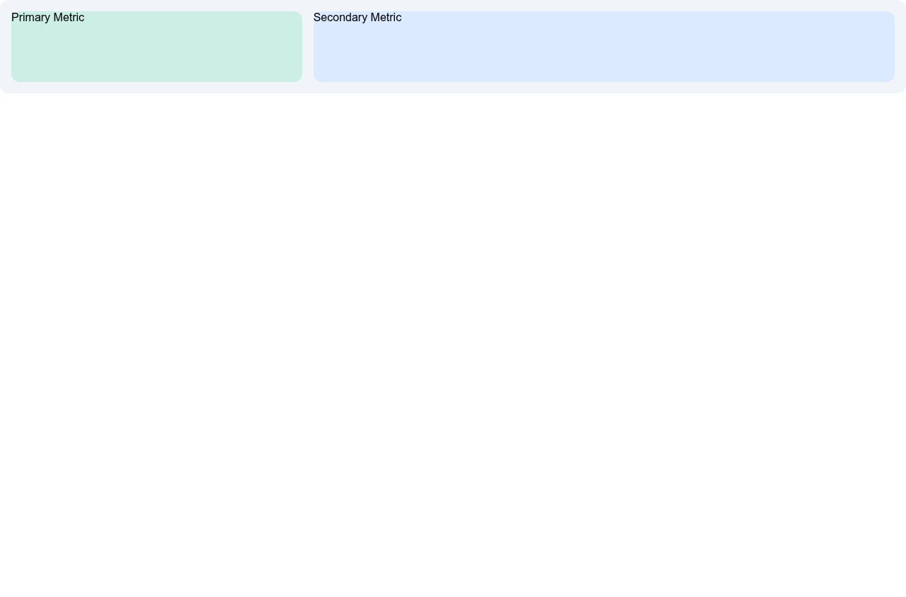

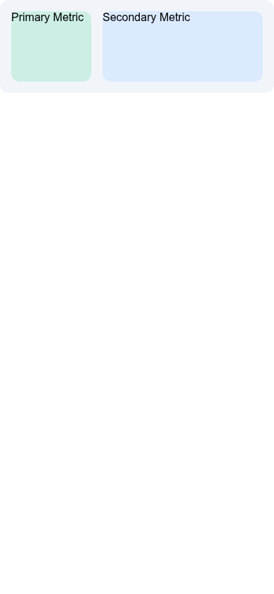

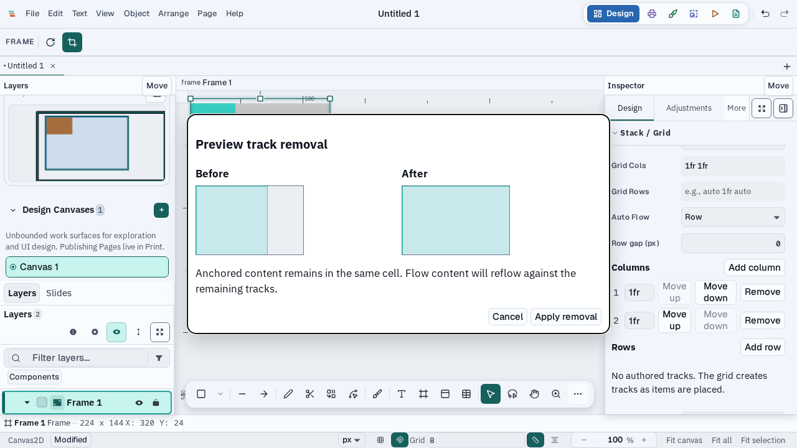

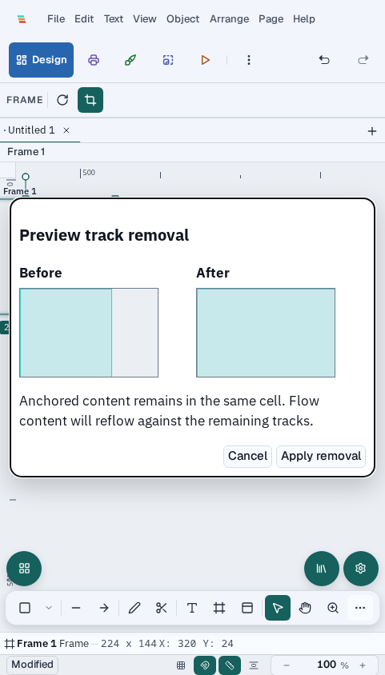

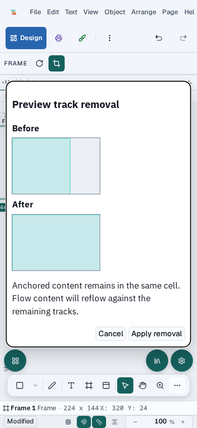

### Captures

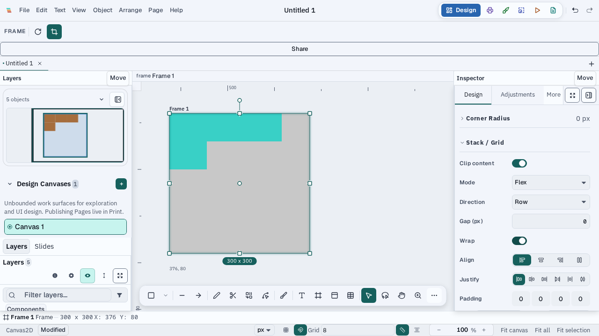

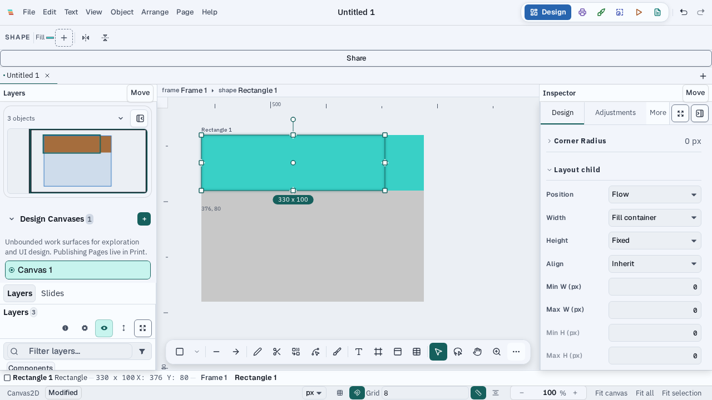

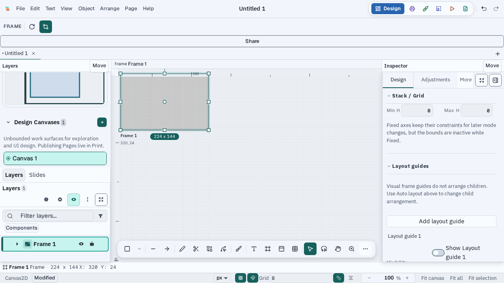

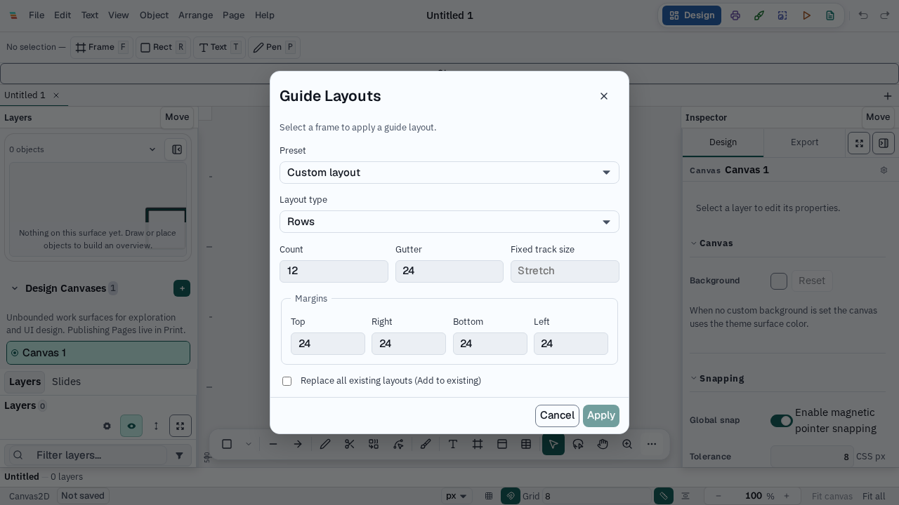

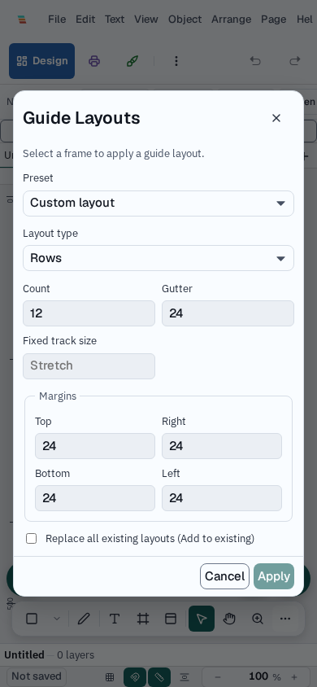

## Limits

These browser checks cover a subset of the requested eight-document corpus. Generated grid CSS was rendered from an isolated IR fixture at two widths; full application exports and breakpoint-specific output remain unverified. The runs also do not cover native Tauri GUI capture, track-handle pointer previews, imported-component first edit, typography/resource loading, collaborative pressure, rotated snapping, or edit-to-correct-frame latency. Those remain unverified.

### Integration-candidate gate follow-up — 2026-10-18

- On `codex/layout-master-integration`, `pnpm verify:plan` initially escalated the 59-path integration to `pnpm verify:full --local` for workspace, schema, and validation-infrastructure changes. The first gate run exposed a validation harness defect: a temporary Git fixture wrote receipts under the invoking checkout instead of its own Git directory. `commonGitDirectory` now creates its default adapter from the requested `cwd`; `node scripts/quality/full-gate.test.mjs` and `node scripts/quality/operation-history.test.mjs` passed afterward.
- The restarted full gate passed format/lint, emoji, health, architecture, workspace and E2E typechecks, CI tooling tests, and the baseline, SIMD, and color WASM builds. The architecture audit reported 14 cycles (below the enforced ceiling of 17) and zero layer violations; reported-only instability, unused-export, complexity, and hub-budget debt remains.
- The full JavaScript suite completed with **22,918 passed, 17 skipped, 3 failed**. Two failures were corrected on the integration candidate: the six direct screenshot paths in `vertical-text-orientation.spec.ts` and `visual-compositing.spec.ts` now use the isolated per-test evidence path, and `presentation.varve` was regenerated from its unchanged source generator. The capture-policy regression test passed (8/8), and the website suite passed (302 tests). The remaining observed failure is an existing timing threshold in `videoExportBridge.test.ts` (445.4 ms measured against a 343.7 ms limit under concurrent machine load). The full gate has not been rerun after these repairs, so the later full-gate lanes remain unverified.
- On the isolated candidate, `pnpm verify:plan` / `pnpm verify:affected` also selected `audit:radius`, which reports ten legacy radius consumers in untouched CSS. Candidate desktop typecheck passed directly after matching the existing collaboration helper's transform type to the scene's readonly tuple. No unrelated CSS or screenshot fixtures were changed.
- Chromium E2E captures in this report were opened and inspected, including the generated responsive HTML/CSS at 1280×844 and 390×844. The new E2E test asserts viewport fit and the 1fr/2fr track ratio. **Native Tauri GUI validation, the broader document corpus, packaged edit-to-correct-frame performance, and full application code export remain unverified.** No publish or deploy was performed.

### Solver review follow-up — 2026-10-18

- Manual review found that auto-height text was not remeasured after flex Fill/shrink width allocation or after grid columns resolved. Focused regressions and fixes are in progress on `codex/layout-reliability`; they are not part of this integration candidate yet.
- For those four changed layout files, `pnpm verify:plan` selected the two layout test files, layout/editor/import/desktop typechecks, and the associated package unit lanes; it did not escalate to the full suite. `pnpm verify:affected` passed formatting, lint, emoji audit, and layout typecheck, then stopped at the editor typecheck on the existing `packages/editor/src/components/Presentation/show/morphMatch.ts:165` cast from `number[]` to `Affine`. The layout package typecheck passed, but the focused solver tests did not run because the shared heavy-task lease was occupied by a live editor unit-test process. The standalone layout typecheck passed before running the affected plan. No change was made to the unrelated presentation cast.
- The additional `vertical-text-orientation.spec.ts` Playwright rerun also remained queued behind that live editor unit-test lease; the earlier E2E results are the only browser results claimed. No native Tauri run or app shutdown was attempted.

### Solver correction verification — 2026-10-18

- The final-width text-measurement correction was committed on `codex/layout-reliability` (`23817cd50`) and cherry-picked onto the integration candidate (`589eb51d9`). The focused `autolayout.test.ts` and `computeGridLayout.test.ts` regressions passed on both branches: 60 tests total. `pnpm --filter @varve/layout typecheck` passed on the integration candidate.
- The documented stable reflow budget benchmark passed all five cases. The current observational profile measured flat 50,000 children at 356.01 ms warm p50 / 408.61 ms p95 and nested 1,024 leaves at 255.67 ms warm p50 / 904.17 ms p95. The unrelated editor unit suite was active during the measurement; values are recorded as a concurrent-load sample, not a before/after claim. Full values and environment are in `docs/perf/layout-profile-2026-10-16.md`.
- On the integration candidate, `pnpm verify:plan` selected 37 lanes for two untracked support files from ongoing shared work (`packages/codegen/src/bundle-assets.ts` and `packages/scene/src/nodeResize.ts`), rather than the committed layout correction. `pnpm verify:affected` was not run against those unrelated files. The committed layout correction was instead checked with the exact focused regressions, layout typecheck, stable benchmark, and diff check. The earlier feature-branch `verify:affected` runs passed the targeted audits and layout typecheck but stopped at an older-base `morphMatch.ts` type error; the integration candidate's current base has the corrected cast.
- No layout-specific browser workflow changes were included in this correction, and no additional Playwright run completed after it because the shared heavy-task lease remained occupied. Existing browser captures above verify the related layout interactions; native Tauri, multilingual/resource-loading, concurrent-edit, and the broader requested document corpus remain unverified.

### Import/export fidelity regression follow-up — 2026-10-18

- Code review of the reported Around/Evenly file-exchange failure found that the Figma importer normalized absent min/max bounds to explicit zero. Layout then clamped imported children to 0×0 on first reflow. The importer now leaves absent bounds unset while retaining authored finite bounds. The same review found semantic HTML/CSS codegen preserved the IR value but omitted CSS `justify-content` for `space-around` and `space-evenly`; both mappings are now emitted.
- Commit `9ad68507a` adds regressions for Figma `SPACE_AROUND`/`SPACE_EVENLY` mapping, `DocumentCodec` save/reopen, distinct child coordinates, absent-bound preservation, and matching CSS output. The focused Figma importer and HTML emitter files passed **24/24**.
- After `pnpm verify:plan` selected 40 lanes, `pnpm verify:affected` passed formatting/lint, emoji/docs audits, E2E typecheck, all selected package typechecks, and all selected unit suites. Counts include codegen 476 passed / 1 skipped; import 410; scene 3,424; editor 8,958 / 2 skipped; desktop 90; AI 24; CLI 23; collab 65; history 217; home 211; layout 92; print 15; prototype 262; UI 718; website 302. The exact importer/emitter files passed 16 + 8 tests, and `bundle-assets.test.ts` passed 15.
- The Tier 4 Chromium `e2e:import` lane completed with all 12 tests passing. The `e2e:export` lane completed 15/16 tests: the responsive grid codegen case passed at desktop and narrow viewport widths, as did compositor, save-picker, native PDF contract, PDF text, and PNG alpha cases. The large PDF text export case failed at `download.path()` after the filesystem returned `ENOSPC`; Playwright also could not write progress evidence or its test-result directory. At verification time only about 190 MB remained on the root filesystem. This environment failure leaves the affected run incomplete; no artifacts or shared worktrees were removed. Native Tauri UI, multilingual/resource-loading, concurrent-edit, broader corpus interaction frames, and renderer parity remain unverified.

### Constraint bounds review follow-up — 2026-10-18

- Code review found that responsive constraint results describe the child bounds origin, while the transform stores the geometry origin. A shape with nonzero local `shape.x`/`shape.y` could therefore shift after a parent resize. Both the layout-frame absolute-child path and the standard frame constraint path now convert the resolved bounds origin back to the resized child's local geometry origin.
- `TransformEngine.test.ts` now exercises a constrained absolute child with local geometry offset `(12, 6)`; all 33 tests pass. `pnpm --filter @varve/editor typecheck`, Biome on both touched files, and the commit checkpoint passed on `33e4fd13e`.
- `pnpm audit:radius` was selected by the planner but failed on 10 legacy CSS radius consumers in unrelated presentation/spec-panel stylesheets. This change touches no CSS.

### Final resource and full-gate follow-up — 2026-10-18

- Reviewed temporary files and removed 33 unused `/var/tmp/*basetemp*` directories last written on 2026-10-11, reclaiming about 1 GB. Pruned five Git worktree registrations only where their recorded `/tmp` worktree directories were already absent. Existing worktrees, shared untracked files, and running processes were preserved.
- After cleanup, the exact previously failing Chromium case (`pdf-text.spec.ts`, `Export large text node to PDF produces valid file`) passed through the repository heavy-task lease: **1/1**. The older full export-lane outcome remains **15/16**; the single failing case is now independently green with available disk.
- A task-only `pnpm verify:plan --staged` over the 62-file feature diff selected 62 lanes and escalated to the full gate for workspace/dependency and validation-infrastructure changes. `VARVE_FULL_GATE_REASON='Layout feature branch includes import dependency and validation-infrastructure changes; planner requires full gate' pnpm verify:full --local` passed format/lint, emoji and health audits, architecture audit, all workspace and E2E typechecks, CI tooling tests, and the three WASM browser-artifact builds. The architecture audit reported 14 existing cycles (under its enforced ceiling of 17), no layer violations, and the established reported-only instability/unused-export/complexity inventory.
- The full gate's JavaScript unit lane ended with **SIGTERM after 48 minutes** (`op-20261018200859223-066e7518-e58c-4cc2-88d8-6f023e9748ff`); the overall full gate is **cancelled/incomplete**, not passed. Two slow editor tests had appeared as failures during that suite. A lease-wrapped isolated rerun of `ShortcutPalette.test.tsx` and `FloatingToolbar.test.tsx` passed **33/33**, so neither failure reproduced in isolation. The full JavaScript suite and later full-gate lanes remain unverified.
- The candidate worktree still contains two untracked files from ongoing shared work (`packages/codegen/src/bundle-assets.ts`, `packages/scene/src/nodeResize.ts`); both are imported by tracked code and were left untouched. The layout branch was fast-forwarded to local `master` at `ab4c84f98`. The primary checkout's unrelated `pnpm-lock.yaml` edit for `packages/automation` was preserved and reapplied alongside the committed layout importer entry. Native Tauri GUI validation, resource/multilingual loading, concurrent-edit pressure, the complete requested document corpus, fresh-reflow comparison, and full application code export remain unverified.

### Grid placement inspector review follow-up — 2026-10-18

- Review found that the inspector rebuilt a full placement from shared numeric values when editing one axis. Identity track anchors displayed as zero, and an edit could discard the other axis, stable track anchors, spans, or per-node differences in a multi-selection. The inspector now resolves identity anchors for display and applies each edit to each selected node's current placement, preserving the other axis and current span.
- The original regression failed before the fix (identity start displayed as 0 instead of 1). The expanded focused test now also verifies a mixed multi-selection: moving both items to column 2 keeps their different spans and row anchors. `TMPDIR=/home/kevina/.cache/varve-layout-tmp pnpm exec vitest run packages/editor/src/components/Inspector/sections/GridPlacementFields.test.tsx --maxWorkers=1 --reporter=dot` passed **5/5**. An earlier run with the default `/tmp` failed before executing tests because the shared 12 GiB `/tmp` tmpfs was full; using the task cache directory provided enough temporary space.
- A post-merge recheck at `182dc0db0` passed **63/63** focused layout tests (`autolayout.test.ts`, `computeGridLayout.test.ts`, and `gridTrackMutations.test.ts`) plus the `@varve/layout`, `@varve/import`, and `@varve/codegen` typechecks. Follow-up typechecks at `56a11e685` passed for `@varve/scene` and `@varve/editor`.
- Editor and desktop typechecks passed. Commit `ab4c84f98` also passed its checkpoint, including staged formatting, health, emoji, docs, security, interaction audit, and focused tests. `pnpm verify:affected` for the follow-up stopped at `audit:spacing` with 30 existing spacing findings in untouched CSS; the separately run `pnpm audit:radius` reports ten legacy radius consumers in untouched Presentation and SpecPanel CSS. `pnpm audit:docs` and `node scripts/audit-architecture.mjs --ci` completed; the architecture audit reported 14 cycles and no layer violations. No new browser interaction was needed for this inspector data-preservation fix; existing browser captures were re-opened and inspected. Native Tauri GUI and the broader corpus/performance checks listed above remain unverified.

### Verification follow-up — 2026-10-19

- On local `master` (`de5f4dcfd`), `pnpm verify:plan --since 5151925f9` selected 31 lanes and escalated to the full gate because the affected history includes workspace and validation-infrastructure changes. The affected command stopped at that escalation as designed. The full gate ran on the isolated layout worktree at `ab4c84f98`; format/lint, emoji, health, architecture, and repository typecheck lanes passed. The architecture audit reported 14 cycles against the enforced ceiling of 17 and no layer violations.
- The full-gate CI tooling lane timed out after 600 seconds while its subprocess waited for another worktree's live canvas E2E lease. No layout assertion failed. `XDG_RUNTIME_DIR=/tmp/varve-layout-ci-tools-runtime pnpm test:ci:tools` was then run separately to isolate the tooling suite's temporary leases; all CI tooling tests and 40 shell checks passed. This standalone lane result does not turn the interrupted full gate into a pass.
- The master-only mixed grid-placement regression was rerun with `TMPDIR=/home/kevina/.cache/varve-layout-tmp pnpm exec vitest run packages/editor/src/components/Inspector/sections/GridPlacementFields.test.tsx --maxWorkers=1 --reporter=dot`: **5/5 passed**. The full gate and native Tauri GUI validation remain pending; the canvas E2E lease was still actively writing trace artifacts at this checkpoint.

### Native desktop launch probe — 2026-10-19

- After the shared Playwright processes exited and port 1420 was free, `pnpm --filter @varve/desktop tauri:dev` completed the Rust development build and launched `target/debug/varve-desktop`. Vite was ready at `http://localhost:1420/`; the desktop process remained alive without startup errors during the probe.
- This session's computer-use bridge exposes no native apps or window inventory (`getState()` returned `apps: []`; `listWindows` and `listApps` are unavailable). The Tauri window therefore could not be visually inspected or driven for layout interaction frames. Treat this as a successful build/launch probe only; native visual validation remains outstanding. The ChatGPT app was left open.

### Full-gate resume result — 2026-10-19

- Resumed the full gate in the isolated integration worktree at `ab4c84f98` with `VARVE_FULL_GATE_REASON='Resume interrupted layout full gate after isolated CI tooling rerun passed and shared browser lease cleared' XDG_RUNTIME_DIR=/tmp/varve-layout-ci-tools-runtime pnpm verify:full --local --resume`. The worktree remained dirty only from the two shared untracked support modules, so the verifier correctly disabled receipt reuse and reran the selected lanes.
- Format/lint, emoji audit, health audit, architecture audit, workspace typecheck, E2E typecheck, CI tooling (40 shell checks), and the base/SIMD/colour WASM browser artifacts passed. `wasm-opt` was unavailable and its optional optimization was skipped. Architecture reported 14 existing cycles (enforced ceiling 17) and zero layer violations; instability, complexity, hub budgets, and unused exports remain report-only findings.
- The full JavaScript lane completed **22,926 passed, 17 skipped, 1 failed** across 2,010 files. The sole failure was `FloatingToolbar.test.tsx` expecting an exact button name `Brush` after keyboard-opening its lazy options panel; the full-run DOM showed the active toolbar button named `Paint Brush`. Re-running that complete file alone under the heavy-task lease passed **15/15**, so the failure is not reproduced in isolation and appears sensitive to full-suite execution/load. No unrelated toolbar code or test was changed.
- The full-gate operation ended failed at the JavaScript lane; subsequent full-gate browser, desktop/package, and performance lanes did not run. Browser interaction evidence in this audit is from the prior Chromium validation sections; native Tauri visual interaction frames remain unverified because native window inspection is unavailable in this session.

### Native Tauri interaction capture — 2026-10-19

- Built the Linux WDIO-enabled Tauri binary with `CARGO_BUILD_JOBS=2` using `pnpm test:desktop:native`; the native build completed successfully. The first run used the test app's existing XDG profile and stopped at save because that profile opened a recovery dialog. Later runs used fresh temporary `XDG_DATA_HOME`, `XDG_CONFIG_HOME`, and `XDG_CACHE_HOME` directories.
- Ran `VARVE_WDIO_SPECS=./tests/wdio/native-fluidity-cycle.e2e.ts` through the embedded Tauri WebDriver provider under `xvfb-run -a dbus-run-session`. Result: **1 passed**. It created a document, drew and painted through synthetic DOM `PointerEvent`s (`trusted: false`), saved, and closed it. The visible editor WebView measured 688.89×583.36 CSS px; the canvas pixel hash changed from 975081157 to 3379885129 with 7,581 detected artwork pixels. The test captured a 1280×800 application frame.
- Opened and inspected the native screenshot. It shows the Tauri editor, selected shape, layers panel, inspector, canvas, and toolbar. The first-run overlay remains visible in this harness, so the native frame is evidence of desktop rendering and interaction, not a native layout-inspector geometry assertion. Layout rectangles, narrow viewport controls, responsive export, and track previews remain covered by the Chromium captures and assertions recorded above.
- The harness emitted a diagnostic warning that `tauri-driver` and `WebKitWebDriver` were not found, but confirmed it was using the embedded provider and the WebDriver session completed. Optional external-driver packages were not installed.
- After the capture, removed the temporary XDG profiles, native failure frames, and the 11 GB test-only Tauri build target created in the integration worktree. Root volume availability rose from 15 GB to 26 GB; shared targets, other worktrees, and running processes were left in place.

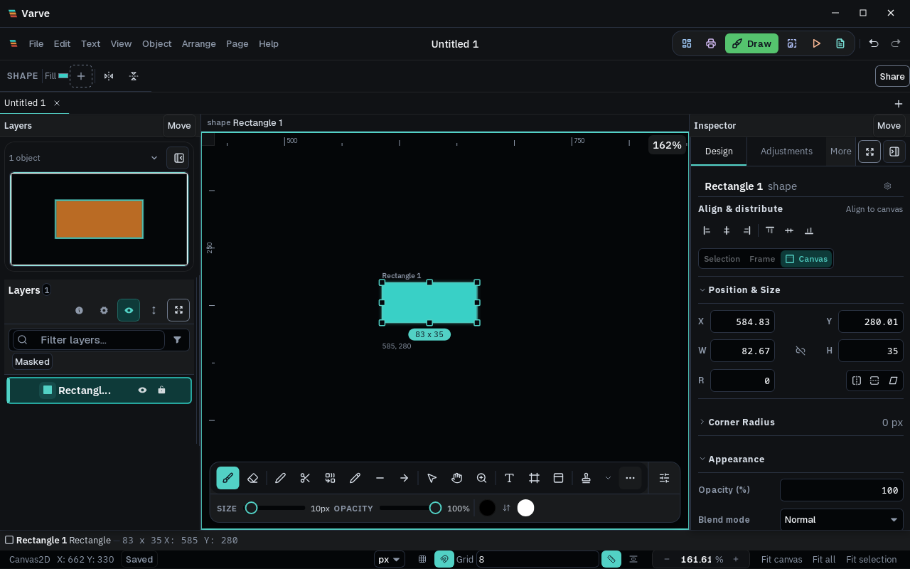

### Focused canvas rerun after interrupted browser batch — 2026-10-19

- A broader leased Chromium batch was cancelled by its wrapper after 39 tests had run. The flow-child reorder case reported a closed page, and the next constraints case could not connect to the stopped Vite server; neither produced a layout assertion failure. The remaining cases in that batch were not run.
- Once the shared browser lease cleared, reran those exact two cases in the isolated integration worktree with one Chromium worker: `11b - dragging a flow child reorders it within its flex frame` and `constraint section shows when child of frame is selected`. Both passed (**2/2**, 2.4 minutes). This confirms those interactions only; the unrun cases and full gate remain outstanding.
- The cancelled batch's temporary Playwright trace bundle was absent after the focused rerun. No other worktree artifacts or active processes were removed during cleanup.

### Track identity review follow-up — 2026-10-19

- Post-integration review found that track removal preview fell back to numeric placement when a child carried a stale persistent track identity. That could turn invalid authored placement into a valid-looking rehome. The preview now rejects a missing identity on either grid axis and preserves the source document for correction.
- Commit `ed9b58ccf` contains the fix and regression; it was cherry-picked onto local `master` as `db9a44081`. The focused grid-mutation file passed **4/4**, the full layout package passed **93/93**, and layout, editor, import, and desktop typechecks passed. The broader `pnpm verify:affected --staged` editor unit lane is still running; no completion is claimed for it yet.

### Flex unresolved-layout feedback review — 2026-10-19

- Static review of `packages/layout/src/computeFlexLayout.ts` and `packages/layout/src/reflow.ts` confirms that non-finite or negative resolved geometry makes `computeFlexLayout` return an empty array, so reflow leaves existing materialized child geometry unchanged. However, minimum-bound overflow can still return finite overflowing rectangles without a typed diagnostic, and the empty-array path does not explain why reflow was skipped to the inspector. This is narrower than the original brief's request to report unresolved layouts.
- The ADR currently lists flex overflow/cycle feedback as deferred. Close this gap before claiming full completion: add a typed flex result with bounded diagnostics, expose it read-only in the layout inspector, and test both minimum-overflow and invalid numeric input while asserting the last valid geometry and history remain unchanged. This follow-up has not been implemented or validated.

### Flex unresolved-layout feedback implementation — 2026-10-19

- Commit `c8879abef` adds `computeFlexLayoutDetailed` while retaining the rectangle-only `computeFlexLayout` adapter. Invalid frame dimensions, gaps, padding, or final rectangles now produce typed diagnostics; reflow continues to preserve the last materialized child geometry when no valid rectangles are returned. Finite items that still exceed the available main axis after shrink-to-minimum remain visible and report `main-axis-overflow`.
- The inspector displays invalid geometry feedback in the danger style and finite overflow in the warning style. Regression coverage checks finite overflow rectangles, invalid frame width, unchanged child transform on invalid bounds, and the visible inspector message. Focused layout and inspector tests passed **54/54**; the complete layout package suite, including its cold/warm profile cases, passed **96/96**. `@varve/layout` and `@varve/editor` typechecks completed without diagnostics; the commit checkpoint passed.
- Review then separated the shrink-disabled example from the minimum-bound case and generalized the inspector copy to describe main-axis overflow. Commit `c39c7ba68` adds two shrinkable 100px items with 90px minimum widths in a 150px row; the solver returns two finite 90px items with `main-axis-overflow`. The autolayout test file and staged affected plan both passed **34/34**; no browser frame was captured for this copy/test-only refinement.
- `pnpm verify:plan --staged` selected the seven task-owned files, with no full-suite escalation. `VARVE_TEST_WORKERS=1 pnpm verify:affected --staged` passed touched-file format/lint, emoji, inspector CSS, and token audits, then stopped at the workspace spacing audit. That audit reported 30 pre-existing/unrelated drift findings in `packages/editor/src/collab/collab.css`, `packages/editor/src/components/FirstRunOverlay/FirstRunOverlay.css`, and `apps/website/src/components/DownloadRedirect.astro`; none are in the staged change. Remaining affected package-wide tests and downstream checks were not reached by the fail-fast verifier. Browser interaction frames and native layout geometry were not captured for this diagnostics-only slice.

### Axis-specific Fill/Hug cycle warning — 2026-10-19

- Review of `cycleDetection.ts` found its checker only read the legacy combined sizing field and could not distinguish a width Fill/width Hug pair from Fill/Hug on independent axes. The inspector had no caller, so the deterministic minimum-contribution cycle break had no visible explanation. The checker now uses per-axis sizing, checks only visible flow children against their immediate auto-layout frame, and ignores hidden/absolute children. The Layout child section displays its warning and explains that geometry still resolves from the child's minimum contribution.
- Tests cover legacy direct Fill/Hug, per-axis sizing overriding legacy values, differing axes, hidden and absolute children, and the real selected-child inspector path. `cycleDetection.test.ts` and `PropertiesPanel.test.tsx` passed **40/40**; layout and editor typechecks completed without diagnostics.
- `pnpm verify:plan --staged` selected the six owned source/test/doc files; after adding the ledger result it selected seven. Neither plan escalated. `VARVE_TEST_WORKERS=1 pnpm verify:affected --staged` passed format/lint, emoji, docs, inspector CSS, and token checks, then stopped at the same 30 workspace spacing findings in unrelated collab, first-run overlay, and website download styles. `pnpm audit:radius` also reports ten legacy consumers in untouched Presentation and SpecPanel stylesheets. The affected compiler/package-test lanes were not reached by the fail-fast verifier, so direct layout/editor typechecks and focused tests were run separately. This warning-only UI change has no fresh browser frame; prior native and Chromium captures do not exercise the warning. The other live editor/Canvas validation jobs were left running.
- `node scripts/audit-architecture.mjs --ci` completed with the layout package cycle-clean, 14 total allowlisted cycle identities across engine/scene/editor (under the global limit of 17), and no layer violations. The scan also reported existing module instability, hub-budget warnings, and large unused-export inventories; these are not CI-enforced by this audit. No cycle identity was attributed to the layout/editor change.

### Editor-authored dashboard grid scenario — 2026-10-19

- Commit `d32febd6e` adds a Chromium workflow to `autolayout-visual.spec.ts`: draw a frame with two card children, switch the frame to Grid, author `1fr 1fr` columns, capture the resolved canvas, then select each card and compare its rendered selection-outline rectangle. Commit `f199bf698` waits for each layer's selected state before reading the outline. The assertions check equal widths, distinct columns, and aligned row placement; screenshots are requested before and after selecting the cards.
- `pnpm verify:plan --staged` selected touched-file format/lint, emoji audit, E2E typecheck, and the canvas spec, with no full-suite escalation. `pnpm exec biome check tests/e2e/canvas/autolayout-visual.spec.ts` and `pnpm typecheck:e2e` passed. The commit checkpoint also passed health, impact-config, E2E-interaction, secret, contact, and import-boundary checks.
- The exact browser lane was queued through `scripts/quality/heavy-lease.mjs` by `pnpm verify:affected --staged`, but the wrapper reached its 600-second wait deadline and failed before launching the spec. Lease owner PID `2721630` remains live with its Playwright runner and Vite server; the queued attempt produced no screenshots or geometry results. No visual pass is claimed. Retry after the live owner exits, then inspect both screenshots and record the assertion/run outcome.

### Center-offset constraint regression recheck — 2026-10-19

- To verify the plan's center-offset resize oracle and responsive absolute-child behavior independently of the browser lease, ran `TMPDIR=/home/kevina/.cache/varve-layout-tmp pnpm exec vitest run packages/scene/src/__tests__/constraints.test.ts packages/editor/src/transform/__tests__/TransformEngine.test.ts -t 'centerOffset|keeps center proportional|constrained absolute children responsive' --maxWorkers=1 --reporter=dot`.
- Result: **3 passed, 39 skipped by the name filter** across the two files. The checks confirm the child center offset remains fixed while its parent changes from 200×100 to 300×200, proportional `center` remains a separate policy, and an absolute child in a layout frame responds when the frame is resized. This is solver/transform evidence; it does not validate rotated pointer interaction, preview cancellation, snapping, or native inspector frames.

### Flex/grid solver matrix recheck — 2026-10-19

- Ran `TMPDIR=/home/kevina/.cache/varve-layout-tmp pnpm exec vitest run packages/layout/src/__tests__/autolayout.test.ts packages/layout/src/__tests__/computeGridLayout.test.ts packages/layout/src/__tests__/gridTrackMutations.test.ts --maxWorkers=1 --reporter=dot` against local `master` at `964d74607`.
- Result: **67/67 passed**. This includes the exact 500px fixed-plus-Fill allocation, 230px wrapped rows with separate physical gaps, vertical wrapping, capped Fill and shrink redistribution, the 300px `auto 1fr` intrinsic contribution, bounded/rejected track syntax, placement collision and span cases, separate grid row/column gaps, and track identity/removal previews. This verifies solver and pure mutation behavior, not the editor grid interaction or its not-yet-captured dashboard screenshots.

### Grid import/export/component integration recheck — 2026-10-19

- Ran `TMPDIR=/home/kevina/.cache/varve-layout-tmp pnpm exec vitest run packages/codegen/src/__tests__/html-emitter.test.ts packages/import/src/figma.test.ts packages/scene/src/component.test.ts --maxWorkers=1 --reporter=dot` against local `master` at `3ee4567c4`.
- Result: **35/35 passed**. Coverage includes grid CSS/placement emission, supported Figma grid track/child placement import and fixed-geometry fallback for unsupported sizing, plus component instantiation, save/reopen, and detach preservation of grid placement. Two existing `component.test.ts` fixtures emit document-validator warnings about orphan nodes while their assertions pass; these warnings were not changed by this task. This package-level evidence does not establish the full editor export-preview workflow or responsive generated output across browser widths.
