# Layout browser visual validation — 2026-10-16

## Runtime and scope

- Chromium project, Playwright 1.62.1, integration candidate `39e28a371889379891ec1d8d25e47da95bc36178`.
- The editor loaded the newly generated baseline and SIMD WASM modules from `just wasm-build`; these runs did not log the earlier TypeScript-stub renderer fallback.
- The clean commit at that master tip references `packages/codegen/src/bundle-assets.ts`, which was still untracked in the shared working checkout. For these scratch integration runs only, the untracked `bundle-assets.ts` and `svgTextLayout.ts` sources were copied into the temporary worktree to let Vite compile. They were not added to the feature branch or merge commit.

## Executed workflows

| Command / case | Result | What was inspected |
|---|---|---|
| `node scripts/quality/heavy-lease.mjs "e2e: wrap, fill and undo layout interactions" -- npx playwright test tests/e2e/canvas/autolayout-visual.spec.ts --project=chromium --workers=1 --reporter=list --grep 'wrap enabled\|child fill sizing expands\|undo reverts layout change'` | 3 passed | Wrapped children, Fill width geometry, and one-step undo. |
| `node scripts/quality/heavy-lease.mjs "e2e: layout guides desktop/mobile visual capture" -- npx playwright test tests/e2e/canvas/grid-system.spec.ts --project=chromium --workers=1 --reporter=list` | 2 passed | Independent guide visibility/history; Guide Layouts controls, 390×844 bounds, validation, keyboard focus, Escape cancellation. |
| `node scripts/quality/heavy-lease.mjs "e2e: responsive constraints parent resize" -- npx playwright test tests/e2e/canvas/constraints.spec.ts --project=chromium --workers=1 --reporter=list --grep 'resizing parent frame propagates constraints'` | 1 passed | Stretched child width followed parent resize. |

The screenshots were opened and inspected. The compact dialog remains within 390×844, has two-column margin controls, and preserves reachable Cancel/Apply buttons. The editor view shows visual guides in their own inspector section, separate from the layout solver. Auto-layout screenshots show children wrapping and a Fill child spanning the available row width.

### Follow-up: responsive grid removal preview — 2026-10-18

- Ran `TMPDIR=/home/kevina/.cache/varve-layout-tmp node scripts/quality/heavy-lease.mjs "e2e: grid track removal responsive preview" -- npx playwright test tests/e2e/canvas/grid-system.spec.ts --project=chromium --workers=1 --reporter=list --grep "previews grid track removal"` on `codex/layout-reliability` at `ed1cc260d` plus the uncommitted diagnostic and inspector follow-up. Result: **1 passed**.
- The editor opened the baseline and SIMD WASM artifacts copied into this isolated worktree from the primary checkout; the run output contained no WASM fallback warning. These are generated artifacts and are not tracked by the feature branch.
- The interaction added two tracks, opened the removal preview by keyboard, checked dialog focus, canceled at 390px and verified focus returned to the visible canvas after the inspector hid, then reopened at 1280px and applied removal as one history entry before verifying one undo. It checked dialog bounds and the two-column/one-column preview breakpoint at widths 481, 480, 390, and 1280px.
- Captured frames were inspected at 1280px, 481px, and 390px. The dialog remains inside the viewport, keeps Before/After geometry and both actions visible, and switches to a single preview column at 480px. The browser assertion also confirmed a single column at 390px. Exact rectangles, track definitions, and history outcome are asserted in the E2E test.

### Follow-up: generated responsive grid export — 2026-10-18

- `pnpm verify:plan` selected `format:touched`, `lint:touched`, `audit:emoji`, `typecheck:e2e`, and the single-file Chromium E2E; full-suite escalation was not selected for this test-only addition. `pnpm verify:affected` passed all five lanes.
- `tests/e2e/export/responsive-grid-codegen.spec.ts` builds a small IR fixture, calls the production HTML emitter, embeds the emitted CSS, and renders it in Chromium at 1280×844 and 390×844. Both runs passed. Assertions check the grid width, document width, 1fr/2fr computed track ratio, child order, and right edge.
- Both captures were opened and inspected. The desktop frame shows a broad two-track dashboard with pastel cards; the narrow frame keeps both tracks visible at the 1:2 ratio without horizontal overflow. Captures are retained below.
- On 2026-10-21, the same production-emitter fixture passed a lease-wrapped Chromium rerun at 320, 375, 390, 768, 1024, 1280, and 1440 CSS pixels. Assertions checked computed track ratios, child order, and horizontal bounds at every width. The retained captures below are the inspected 390px and 1280px frames; this rerun did not add screenshots for the other five widths.

### Follow-up: imported grid first edit — 2026-10-21

The real file-picker Chromium case in `tests/e2e/canvas/figma-import.spec.ts`
passed with an imported three-track grid and two visible, filled children. It
asserted `100px 1fr 2fr` before editing, retained those tracks after adding a
fourth, checked the children's 1–2 and 2–4 column ranges, and confirmed one
undo restored three tracks. The inspected frames show the two cells side by
side before and after the first edit, without stacking. This fixture is Figma
JSON accepted through the `.fig` picker; native `.fig` grid archive coverage
remains separate.

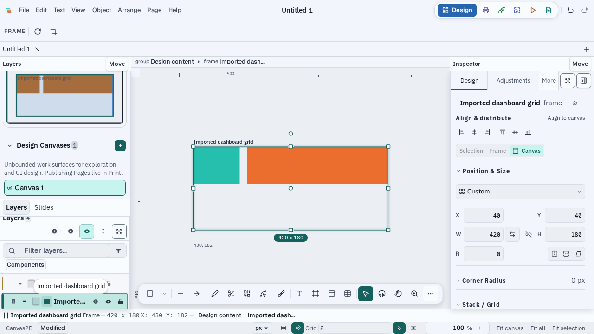

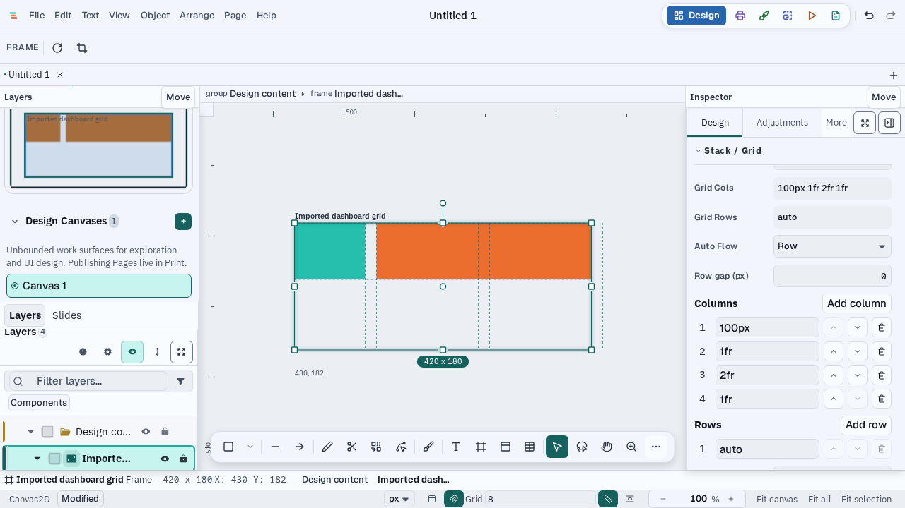

### Captures

## Limits

These browser checks cover a subset of the requested eight-document corpus. Generated grid CSS was rendered from an isolated IR fixture at seven widths; full application exports and breakpoint-specific output remain unverified. The later native Tauri capture covers one grid workflow but does not cover track-handle pointer previews, imported-component first edit, typography/resource loading, collaborative pressure, rotated snapping, or native frame latency. The browser import case covers a Figma JSON grid through the picker, not a native grid archive. Browser edit-to-frame timing has one contended observational grid sample in the performance ledger; it is not a qualification for the broader corpus.

### Marketing site review — 2026-10-21

The local Astro build completed with 126 pages. Its built output was served on
`127.0.0.1:18999` and opened in headless Chromium with Playwright 1.62.1. The
auto-layout feature page and grid documentation page were captured and inspected
at 390, 768, 1366, and 1536 CSS pixels, each at 768px viewport height. At all
eight page/width combinations, `document.documentElement.scrollWidth`,
`document.body.scrollWidth`, and `innerWidth` agreed; the header and main
content rectangles also stayed within the viewport. This confirms the built
marketing pages at these widths, not the editor's layout interactions.

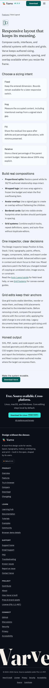

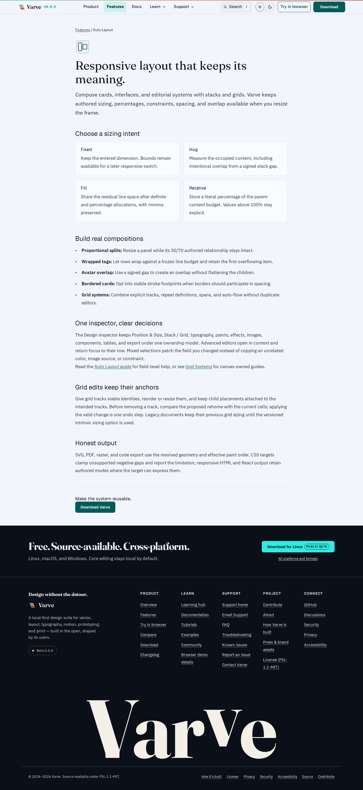

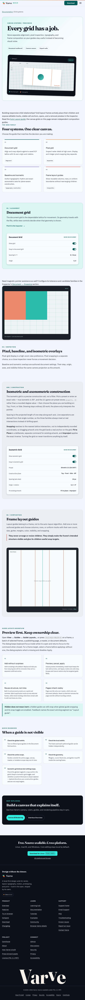

### Grid overlay and compact track dialog rerun — 2026-10-21

The first clean-branch Chromium run reproduced a stale selected-grid overlay:
adding the second column changed the Inspector template to `1fr 1fr`, but the
overlay alpha hash remained `3909351269` for 10 seconds. `useOverlayDraw`
depended on selection and preview props but not the document; the authored
track change therefore did not schedule a new overlay frame. Passing the
immutable scene document as a draw dependency fixed the repaint. The
lease-wrapped focused rerun of `tests/e2e/canvas/grid-system.spec.ts` with
`-g 'previews grid track removal'` passed (1 test, Chromium, one worker).
It asserts a changed overlay hash immediately after adding a track, valid
track counts, invalid draft feedback, keyboard-opened removal preview,
Escape/focus return, and one-undo restoration.

The interaction frames were opened and inspected. The live overlay shows the
new center track at 1280×800. The removal dialog fits inside 1366×768 and
900×700 with two preview columns, and inside 390×844 with one preview column
and both actions visible. These are browser captures; native Tauri evidence
remains separate.

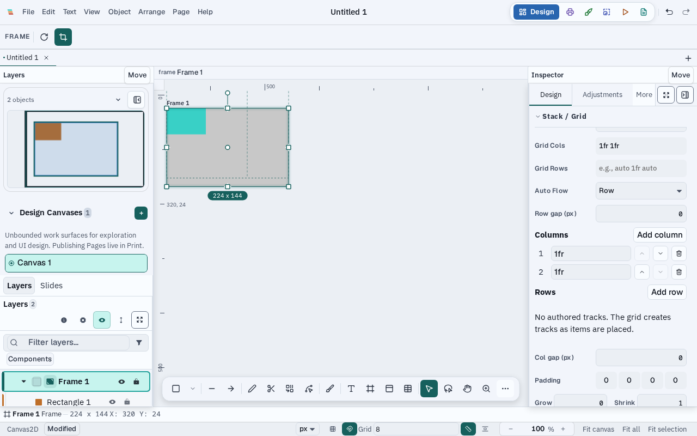

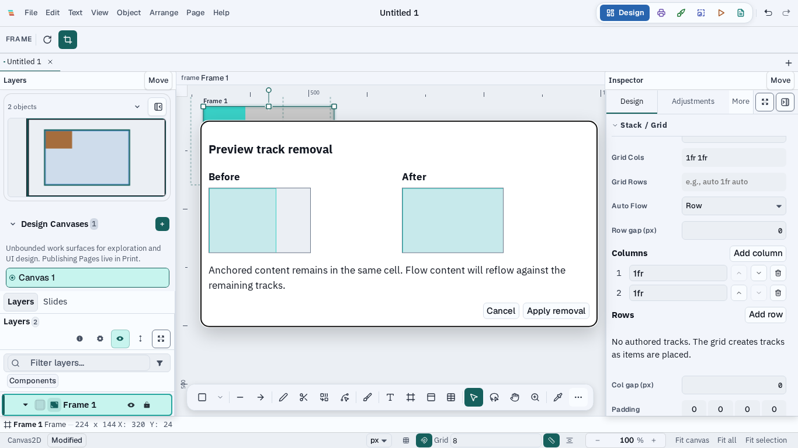

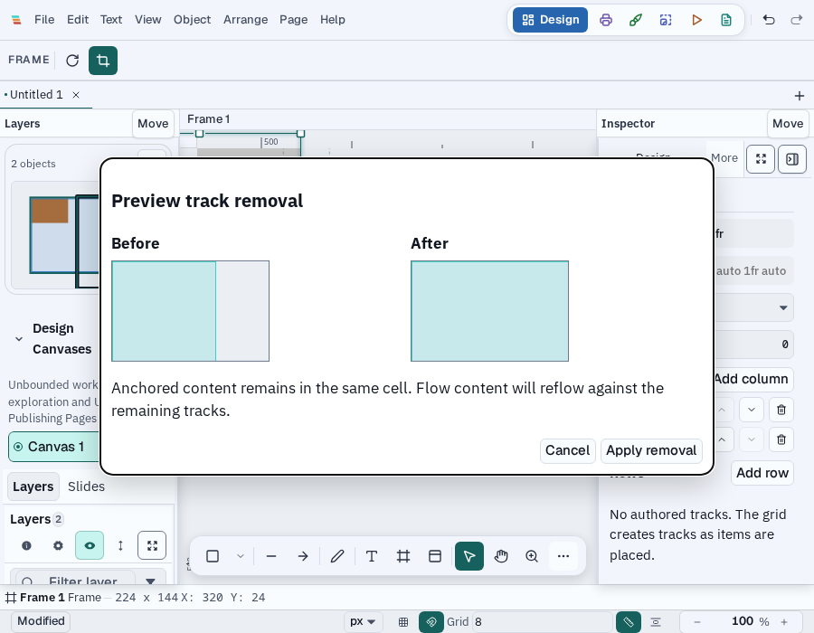

### Native Tauri grid workflow — 2026-10-21

The isolated `pnpm desktop:build:test` built the Tauri test binary, and the
lease-wrapped `pnpm exec wdio run wdio.conf.ts` executed
`tests/wdio/layout-grid.e2e.ts` in WebKitGTK 605.1.15 on Linux. The one native
spec passed (17.8 seconds of interaction, 21 seconds total spec time). It
authored a frame and two cards, switched to a two-column grid, asserted the
cards have equal widths, share a row, and keep a gap at 900×600, 1280×800,
and 1600×1000. At 900×600, the grid placement section remained reachable by
scroll. The native inspector then added a track, opened and cancelled the
removal preview, and restored the prior track count with one undo. The WDIO
service emitted a mock-store cleanup warning after its passing spec; the
process exited 0. The screenshots below were opened and inspected. This
source snapshot predates the separate responsive-toolbar branch, so the
compact native frames will be rerun after integration.

A second isolated native run passed after adding compact track-control bounds
checks. A requested 820px native window stayed at a 900px WebKit viewport,
matching `tauri.conf.json`'s `minWidth: 900`; the first assertion against the
requested width was a test error, not a control overflow. At the actual 900px
viewport, all six Move controls were 28px wide and within the viewport.
The 900×600 controls frame was inspected. Chromium covers the true 820px
responsive mode separately.

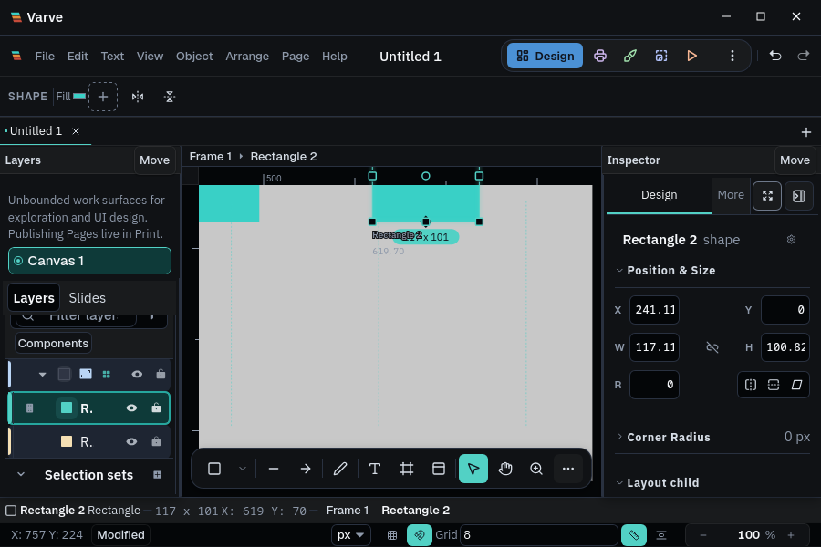

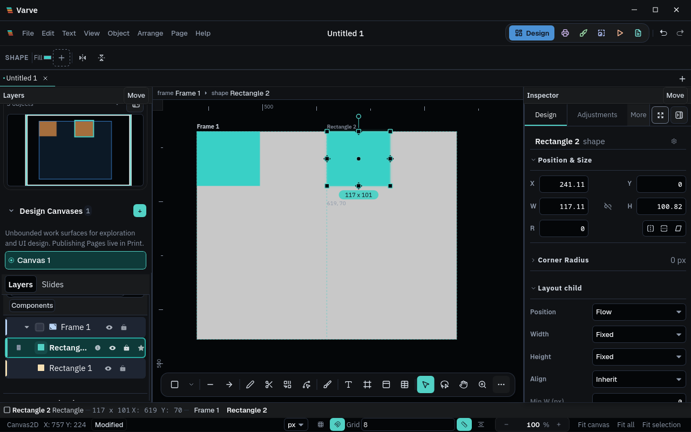

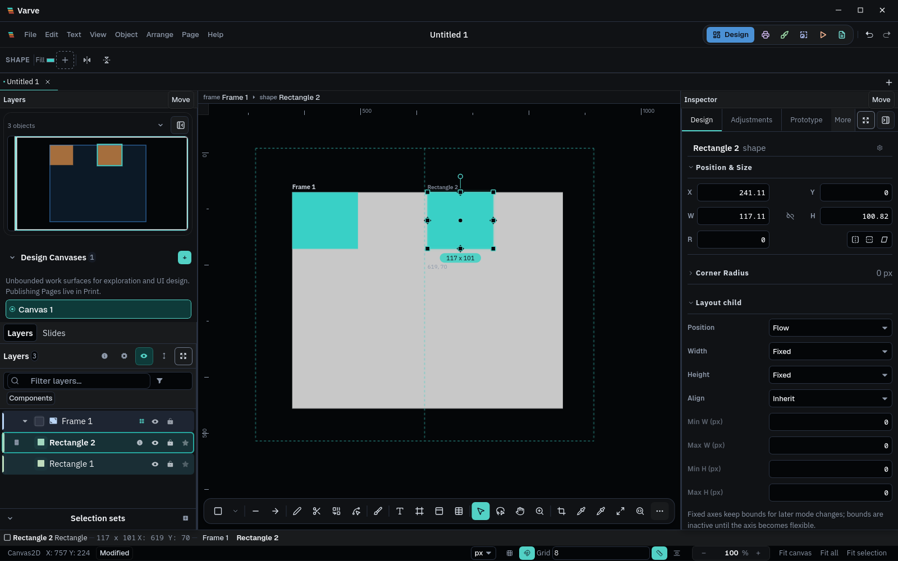

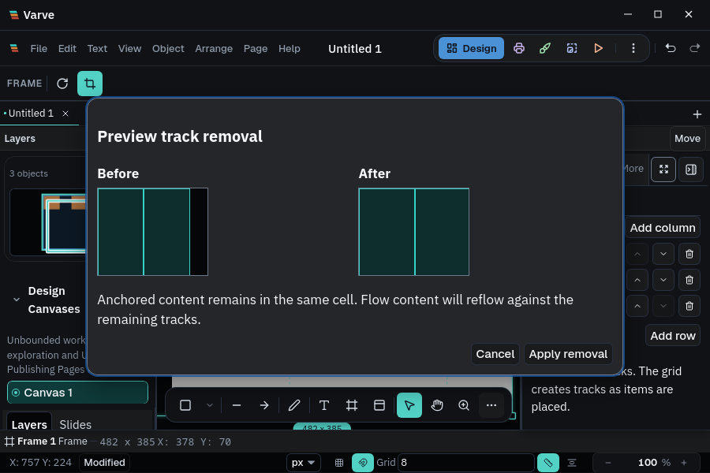

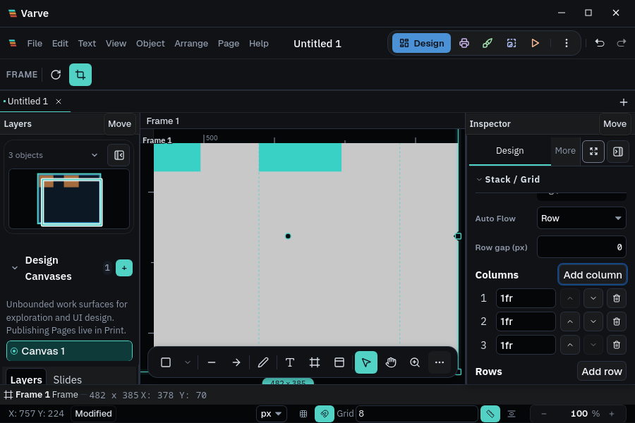
