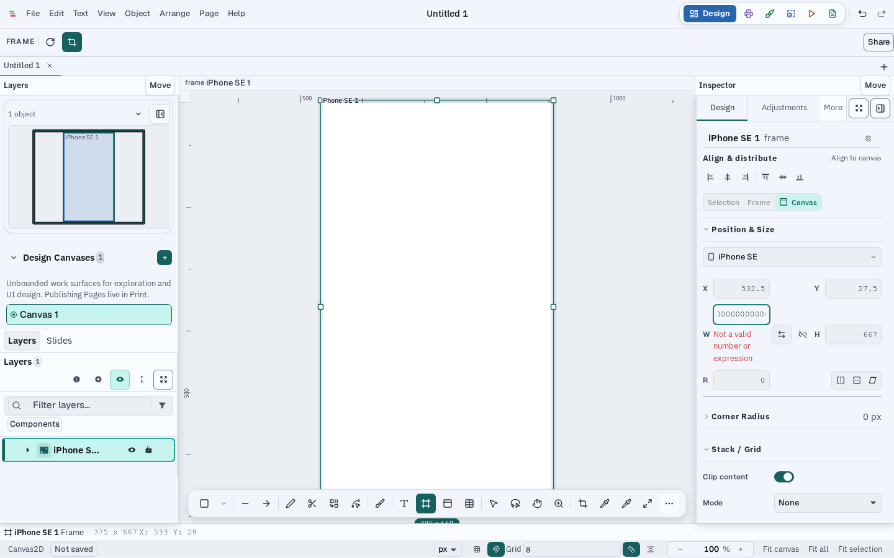

# Photocraft findings and implementation batches

Status: active. Research status and Varve engineering status are tracked
separately. The frozen issue inventory is not an exhaustively reviewed corpus.

## F-001 — Non-finite numeric values can corrupt document state

**Sources.** [Photocraft #6862](https://github.com/storytold/photocraft/issues/6862)
(three-party issue report with two comments); linked [PR #6863](https://github.com/storytold/photocraft/pull/6863)
was open at the source cutoff. The issue says a JSON numeric value such as
`1e39` becomes `f32` infinity and prevents subsequent save. The first comment
links the proposed fix; a bot comment suggests #1101, #5752, and #6424.
#5752 (gradient/pattern assignment) and #6424 (commands) share the f32
narrowing symptom. Their issue discussions and linked PRs #5753/#5831 are now
reviewed. The two fill-angle PRs remained competing open changes at cutoff B;
review found the first still silently ignores a malformed non-array phase.
#6424 links #5752, #4201, and #4181, which remain in the numeric overflow
frontier for Varve-specific boundary comparison. #1101 concerns the opposite direction—
serialization of a non-finite adjustment value—and its commenter supplied a
failing engine round-trip test. Varve's existing adjustment normalization
replaces the invalid parameter before encode; a new encode/decode regression
covers #1101 separately. #6862 is only an analogue: Varve document and bridge
numeric fields use JavaScript/Rust `f64`, so finite `1e39` does not narrow to
infinity on those paths. Varve separately rejects JSON values that parse as
non-finite JavaScript numbers, such as `1e309`; that is a different boundary
guard and does not reproduce PhotoCraft's reported save failure. Bot links do
not establish equivalence.

**Varve applicability and reproduction.** Varve previously accepted JSON
`1e309` as JavaScript `Infinity` during `DocumentCodec.decode`; a focused
regression reproduced acceptance of `opacity: 1e309`. Expression evaluation
also returned infinity for finite operands whose arithmetic overflowed. The
Inspector's `parseField` therefore had a path to write a non-finite number.

**Comparable-app complaint check.** In [Photopea #4899](https://github.com/photopea/photopea/issues/4899),
a user reported that an existing graphic could neither accept image layers nor
save, while the same image worked in a new file. The thread does not establish
the root cause or a general Photopea failure rate, so it is used only as a
failure-mode example: when document-specific content blocks both editing and
save, users need a clear error and protection against replacing the affected
file with an empty document. Varve's invalid-open and finite-number guards
address that recoverability boundary.

**Batch A implementation (focused tests and browser visual validation passed; full validation and integration remain).** Reject the first non-finite value at
the document decode boundary and return its path; reject non-finite expression
results; preserve the prior Inspector value with an accessible validation
error; refuse invalid Open requests without replacing the active document or
binding a blank fallback to the source path. Tests cover codec, expression,
field parsing, open-session preservation, and a real-browser Inspector flow.

**Engineering status:** the independent Varve decode/expression fixes are present
in `codex/photocraft-source-review`, not yet fully validated/reviewed/integrated.
See continuation for commands and exact status. **Research status:** #6862 body
and all comments read; PR #6863 body, changed files summary, and full discussion/
timeline reviewed (open with one commit and no reviews at cutoff B); #5752, #6424,
and #1101 bodies and discussions read; recursive evidence remains open.

**Visual evidence.** Playwright passed against the real Inspector field at
1440×900. The before screenshot shows width 375; after entering a 309-digit
finite value that overflows during expression evaluation, the field shows an
accessible validation message and the model value remains 375.

**Website impact:** reviewed; no change needed until release because this is a
correctness fix and does not alter a public product claim. Architecture and
Inspector behavior docs are updated in this batch.

## F-008 — Native path lowering must enforce its vertex budget before allocation

**Sources.** Photocraft's hostile-geometry reports include [#4427](https://github.com/storytold/photocraft/issues/4427)
and [#4429](https://github.com/storytold/photocraft/issues/4429). They are
external reports, not proof of a Varve fault.

**Varve applicability.** Source review found that native `flatten_contour`
reserved `points.len() * 8` and could emit as many as 64 vertices for each
cubic segment before `lower_frame` checked the aggregate frame budget. The
existing source-size limit does not bound this derived work tightly enough for
native lowering.

**Implementation.** Flattening now accepts a remaining-vertex budget, limits
initial capacity to that budget, refuses before appending beyond it, and maps
budget refusal to `RejectReason::OutOfBudget`. The saturation guard also avoids
overflow in the subdivision estimate. A focused regression exercises a small
budget and an accepted larger budget. Rust validation is pending.

**Website impact:** no copy change is justified. This is defensive handling of
untrusted document geometry and does not change a user-facing capability claim.

## F-009 — Download-only Save As must not make a session clean or discard recovery

**Sources.** The user-visible failure class appears in the complete review of
PhotoCraft #3301–#5000, including reported save-success/dirty-state mismatches
([#4953](https://github.com/storytold/photocraft/issues/4953),
[#4962](https://github.com/storytold/photocraft/issues/4962)). The reports are
cross-checks; Varve's own save-target contract determines the fix.

**Varve applicability.** The documented `download-only` target has no
persistent writable destination and must stay dirty. Save As adopted that
target but marked the document clean and deleted recovery. The lifecycle
coordinator also trusted the returned success boolean without checking the
session's dirty state, so a shutdown Save As could commit after only a browser
download hand-off.

**Implementation.** Download-only Save As now remains dirty, does not clear
recovery unless a persistent destination or existing library mirror has the
exact snapshot, and does not show a saved state. Termination Save As checks
`isSessionDirty` after the write and keeps prompting with a conflict if the
session is still dirty. The browser-demo guidance now explains that a download
is accompanied by a local copy only when browser storage accepts the write;
otherwise Varve keeps the modified state and recovery copy. Regressions cover
the persistence state, recovery preservation, and termination postcondition.
Focused validation is pending.

**Website impact:** updated the browser-demo save/recovery guidance to state
the storage-failure outcome. No landing-page capability claim changed.

## F-010 — Save and close must remain bound to the requested tab

**Sources.** PhotoCraft #1098 reports a background-tab save-and-close path that
can target the wrong active document; #1100 documents the adjacent regression
class where closing a background tab changes which document remains active.
These are external reports, not proof of a Varve defect.

**Varve applicability.** The termination coordinator already checks its
requested session after saving, but `TabStrip` had a separate path that
switched to the requested tab, called the global save action, then force-closed
the tab after a successful result. A download-only save or an edit during an
async save could leave the session dirty and still close it.

**Implementation.** The tab-strip path now switches to the intended session
before saving, then calls the guarded `closeTab` operation. If the save result
does not actually clear dirty state, it keeps the tab open and reports the
reason. `closeTab` reads current state for its dirty guard. Regressions cover
successful save-and-close, a background tab, and a successful write that leaves
the session dirty. Focused validation is pending.

**Website impact:** no public product claim changes; this protects the existing
multi-document save and close behavior.

## F-002 — Atomic replacement could overwrite read-only files and change their mode

**Sources.** PhotoCraft's filesystem tracking issue [#6617](https://github.com/storytold/photocraft/issues/6617)
links the concrete read-only-save reproduction [#6600](https://github.com/storytold/photocraft/issues/6600).
The report demonstrates that on Linux/macOS a same-directory rename can replace
a `chmod 444` document because the operation checks directory permissions,
not the destination file's write bits. The tracking issue also separates
hard-link breakage (#6602), metadata loss (#6603), orphaned staging files
(#6604), and dangling-symlink replacement (#6605); those are independent
behaviors and are not claimed as fixed here.

**Varve applicability and reproduction.** `write_file_atomic` used sibling-temp
replacement without checking the destination's `readonly()` state. On Unix,
this permits replacing a read-only file when the parent directory is writable.
The staging file also inherited only the process umask, so replacement could
change the prior mode (for example, a 0600 document becoming 0644).

**Batch B implementation.** Refuse a read-only destination before creating a
staging file; fail closed if target metadata cannot be inspected; and copy
the existing permissions to the staged file before syncing and replacing it.
Regression tests assert that the original bytes survive a read-only write
attempt and that a writable 0640 file remains 0640. Atomic replacement and
same-filesystem staging remain intact.

**Engineering status:** focused Linux native tests passed (3 tests covering
replacement, read-only refusal, and mode preservation). The exact-SHA local
full gate passed formatting/lint, architecture, health, all typechecks, CI
tooling, and WASM lanes; its Vitest lane had two unrelated baseline failures
and a benchmark timing failure that passed when rerun alone under the heavy-task
lease. Code review of the complete branch and final integration are pending.
**Research status:** #6617 and the
full discussions for #6600–#6605 were reviewed; related same-path and recovery
issues remain under Varve applicability review.

**Website impact:** no public claim describes filesystem permission or metadata
preservation, and this fix does not add a new marketed capability; no website
copy change is warranted before release.

## F-003 — Save destinations can belong to another open document

**Sources.** PhotoCraft [#6597](https://github.com/storytold/photocraft/issues/6597)
reports that Save As on one tab can replace another open tab's file, leaving the
first tab looking saved while its in-memory contents are later lost. Its
discussion says the guard covers Save, Save As, and Save a Copy. The source's
linked [PR #6630](https://github.com/storytold/photocraft/pull/6630) handles
duplicate opens and path identity; [PR #6632](https://github.com/storytold/photocraft/pull/6632)
adds same-file comparison, including hard links on Unix. These are now merged
upstream. PhotoCraft #6596 separately covers external edits, which Varve already
checks for native saves with a content hash.

**Varve applicability.** The editor previously wrote a selected target before
checking whether another active session was bound to it. Exact-path open
deduplication does not protect Save As when aliases or hard links identify the
same file.

**Batch C implementation.** Before native, browser-handle, or library writes,
check the active session list for another owner. Native desktop paths compare
through the `same-file` OS identity API; browser handles use
`FileSystemFileHandle.isSameEntry`, and Varve Library destinations compare
their stable IDs. Save, Save As, and Save a Copy all refuse
the write with an actionable status message. If native identity inspection
fails, the save fails closed. Tests cover Save As and Save a Copy refusing an
aliased native target, Save refusing another session's native target, and a
Rust check for hard links plus ordinary new destinations. The regression also
found that Save a Copy cleared failure status after a refused write; failed
copies now keep the error visible.

**Engineering status:** implementation is present on the source-review branch;
focused regressions pass. The planner-required exact-SHA full gate and final
integration remain. See continuation for exact commands and results.
**Research status:** #6597 and all its comments were reviewed, as were linked
PRs #6630 and #6632; further linked issues and the broader PR census remain
open.

**Website impact:** no public claim describes multi-tab save collision handling;
this correctness behavior does not change a marketed capability, so no website
copy change is warranted before release.

## F-004 — Interrupted native saves can leave large hidden staging files

**Sources.** PhotoCraft [#6604](https://github.com/storytold/photocraft/issues/6604)
reports that killing the app during a large write leaves hidden sibling
`*.pcsave.tmp` files in the user's document folder, with later saves and
launches never removing them. Its bot link to [#3489](https://github.com/storytold/photocraft/issues/3489)
was checked: that report describes orphaned autosave bundles and abandoned
save temps, and proposes sweeping only old artifacts not belonging to an
active process. The bot link to [#203](https://github.com/storytold/photocraft/issues/203)
is adjacent: it documents the data-loss risk of in-place writes and the
importance of retaining atomic replacement.

**Varve applicability and reproduction.** `write_file_atomic` writes to a
unique sibling `.varve-write-<timestamp>.tmp`, syncs it, then atomically
replaces the target. Ordinary error returns remove the current staging file,
but process termination bypasses that cleanup and there is no stale-temp sweep.
The target remains protected, while abandoned bytes can accumulate in the
same directory indefinitely. The regression seeded aged, recent, and
non-generated names, performed a save, and verified only the stale generated
regular file was removed; a Unix test verifies a staging-shaped symlink stays
in place.

**Decision and acceptance.** Throttle sweeps to one per destination directory
every five minutes per process. New staging names include the writer PID;
remove those only after the PID is confirmed exited, and retain files when
process status is unknown. Legacy timestamp-only names are removed only after
24 hours. In both cases, remove regular files only, and leave files with live
or unknown owners, symlinks, and malformed lookalike names untouched. Treat
directory enumeration and cleanup as best-effort so cleanup cannot make a valid save fail. Keep
same-directory atomic replacement and existing destination bytes intact on
write failure.

**Batch D implementation.** Before writing the new staging file, the first
save to a directory performs a best-effort sweep no more than once every five
minutes in the process. New temp names carry their writer PID and are removed
once that process is confirmed gone; legacy temp names require a 24-hour-old
modification time. The sweep leaves live or uncertain owners, malformed
lookalike names, and symlinks alone.
Directory enumeration or unlink errors do not fail the save, and atomic
replacement remains unchanged.

**Engineering status:** implementation is present and the five focused native
`atomic_write_` tests pass, including legacy stale-file removal, dead-owner
cleanup (including recent abandoned files), live or unrepresentable-owner
retention, lookalike-name retention, and symlink retention. A final
read-only review caught and fixed the Unix case where a PID outside `pid_t`
could otherwise be treated as dead; out-of-range owner status is now unknown
and retained.
Rustfmt, documentation, emoji, and token audits pass. The planner escalates to
the full suite; its two attempts are recorded in the continuation report, and
the full gate remains incomplete.
**Research status:** #6604 body and comment, #3489 body and comment, and #203
body were reviewed from the cutoff cache. No implementation or release claim
from PhotoCraft is assumed to apply to Varve.

**Comparable-app failure checked.** Inkscape [#260](https://gitlab.com/inkscape/inkscape/-/issues/260)
reports a truncated, unusable document after a save-time crash and asks for
write-then-replace atomic saving. That is a different failure from orphaned
temp cleanup. It supports retaining Varve's atomic replacement while adding
only bounded cleanup; it is not evidence that Varve's target is corrupted.

**Website impact:** reviewed current save, recovery, and local-first pages; none
claims that native staging artifacts are automatically removed. No marketing
edit is justified for this internal cleanup behavior.

## F-005 — Atomic save can replace a symbolic link

**Source.** PhotoCraft [#6605](https://github.com/storytold/photocraft/issues/6605)
reproduces saving through `link.psd` when it points to a missing relative
target. The current file becomes a regular file and the link is lost. The issue
accepts either writing through the link target or reporting that its target
folder is unavailable. Its bot comment links #6426; that report concerns
automation-root path containment and does not share this document-save
behavior. It was reviewed and classified as unrelated.

**Varve applicability and reproduction.** `write_file_atomic` atomically
renames a sibling over the provided path. For an existing symlink, the rename
replaced the link itself; for a dangling symlink, target metadata appeared
missing and the same replacement happened. The regression first reproduced
both cases: a live link disappeared instead of updating its target, and a
dangling link was silently replaced while the target path stayed absent.

**Decision and acceptance.** Resolve a file-level symlink before choosing the
staging directory and replacement path. Saving through a live link updates the
canonical target and preserves the link. If the link target cannot be
resolved, fail with a clear error while keeping the link and not creating
missing target directories. Keep atomic replacement for the resolved target.

**Batch E implementation.** Approved user-selected native paths resolve an
existing file-level symlink before atomic replacement. The shared atomic writer
refuses an unresolved symlink with an actionable error, while app-managed
writes keep their own path policy. Two Unix regressions cover preserving a
live link through the approved resolver and refusing a relative dangling link
without changing it or creating its target directories. The full focused suite has seven passing
`atomic_write_` tests; broad verification remains required for the accumulated
branch.

**Comparable-app report checked.** Inkscape
[#9776](https://gitlab.com/inkscape/inbox/-/issues/9776) describes users whose
linked image paths break after reopening documents stored in a symlinked
folder. It is adjacent path-resolution evidence, not the same atomic-rename
failure or proof that Varve shares Inkscape's reported behavior.

**Website impact:** this is native filesystem path handling, not a released
capability claim. Reviewed save, recovery, and local-first pages; no marketing
edit is justified.

## Save-path follow-up: identity, metadata, memory, and recovery

The PhotoCraft filesystem cluster (#6602, #6603, #6607, #6611, #6615) has been
compared against Varve's implementation rather than treated as one save bug:

- **Hard links (#6602) are confirmed exposure.** Native document writes use
  `write_file_atomic` and replace the destination with a staged file. This
  preserves crash safety but changes the file identity, so other hard links
  keep the old bytes. Varve's same-file guard detects hard links for
  destination-collision checks; it does not preserve aliases during save. Do
  not change this path to in-place writes without explicitly accepting the
  crash-loss tradeoff. A safe next step needs a user-facing policy and
  platform-tested hard-link count handling.
- **Metadata loss (#6603) is confirmed on the native replacement path.** The
  staged file currently preserves permission bits, but not extended
  attributes, ACLs, creation time, or Windows named streams. macOS `copyfile`
  documents `COPYFILE_METADATA` as POSIX metadata, ACL, and xattr copying;
  Windows `ReplaceFileW` preserves several attributes, ACLs, creation time,
  and named streams. These APIs have different error and replacement
  semantics, so silently copying best-effort metadata is not an adequate
  cross-platform fix. The issue remains open for platform-specific design and
  native verification. The adjacent PdfCraft #3042 implementation is an
  unmerged proposal, not validation for Varve.
- **Save memory (#6607) is partially addressed.** A representative 16 MiB
  embedded-image document encoded to 21.3 MiB JSON; serialization alone raised
  measured peak RSS by 58.2 MiB in a Node probe. This is not a complete Tauri
  save measurement. The native external-change check now hashes the old file
  in 64 KiB chunks instead of returning its complete text over IPC. The newly
  encoded document and atomic writer still use whole-document buffers, so
  per-format/backend measurement remains necessary before changing those
  routes.
- **Malformed settings (#6611) is a partial analogue.** Varve's JavaScript
  loader does not reproduce PhotoCraft's all-preferences reset for one bad
  scalar, but generic merges previously accepted wrong-typed values and could
  pass them to consumers. `mergePartial` now defaults type-mismatched values
  for non-null defaults while preserving sibling settings. This does not validate
  enum strings or nested object members that still have the expected outer
  type, show a recovery notice, or persist a repaired copy; it is a targeted
  safety improvement, not full parity with PhotoCraft's merged #6641 fix.
- **Browser recovery (#6615) is covered in Varve's normal browser path.** The
  editor stores crash-recovery snapshots in IndexedDB and offers recovery on
  the next launch. Storage denial or quota exhaustion remain failure cases to
  assess; Varve does not promise recovery when the browser refuses durable
  storage.

No marketing-site claim currently describes hard-link, metadata, save-memory,
or crash-recovery behavior, so no website copy change is justified before an
implemented and released improvement.

## Remaining filesystem tracker dispositions (#6596–#6617)

The tracker and adjacent reports were checked against the same Varve boundary:

- #6596 is covered by Varve's external-change checks, while #6597 is covered
  by F-003's cross-session destination guard. #6598 is only partial: a second
  open may still create a second session, but the write guard prevents silent
  concurrent replacement. Open-session deduplication remains a separate UX
  decision.
- #6601 was a confirmed native-path limitation. Varve now refuses paths it
  cannot represent as UTF-8 at startup open, macOS OS-open, native drag/drop,
  and Tauri Open/Import/Save dialog boundaries, with user-facing recovery
  guidance. Forwarded single-instance paths containing U+FFFD are refused
  because the plugin may already have replaced invalid native bytes. This is
  safe refusal, not arbitrary native-path support; recent-file paths remain
  UTF-8 strings. See the implementation and platform limits in
  `docs/architecture/filesystem-boundary.md` and the change record in
  `continuation.md`.
- #6606 matches `write_file_atomic`, which creates missing parent directories.
  This may be useful for batch destinations, so a fix should distinguish
  explicit document Save As from export and app-managed writes rather than
  changing the shared helper indiscriminately.
- #6610 is covered in Home: inaccessible desktop paths are marked missing and
  open failures update recent-file state. #6612 is partially covered: Varve's
  recovery data is outside the Linux config directory, but Tauri's
  `app_local_data_dir` resolves under XDG data, while the XDG specification
  reserves `XDG_STATE_HOME` for state data. The report's config-sync failure is
  therefore not the same Varve failure, but a migration to the canonical state
  directory may still improve placement. Review PhotoCraft PR #6941's
  migration and storage-denial policy before changing this boundary. On macOS,
  keeping recovery under Application Support avoids purging it with Caches.
- #6608/#6609 describe linked smart objects and Photoshop external-link
  records. Varve's image assets are document-owned/content-addressed and no
  equivalent linked-smart-object workflow was found; these reports do not
  establish a current Varve defect. #6617 is a tracking issue, not a separate
  failure. Export-name reports #6613/#6614 were checked against Varve's batch
  export workflow; see F-006 and the issue ledger dispositions below.

## F-006 — Duplicate batch export names can overwrite earlier outputs

**Sources.** PhotoCraft [#6613](https://github.com/storytold/photocraft/issues/6613)
reports that distinct artboards can sanitize to the same filename and the later
export silently replaces the earlier one. #6614 reports the same failure class
for generated image assets. These are distinct from the hard-link behavior in
#6602: here the application itself issues two writes in one batch.

**Varve applicability.** The Export dialog already runs job names through
`applyExportBatchPaths` and the shared collision resolver, which renames
colliding jobs. However, `ExportService.run` is also a public execution boundary
and accepted duplicate filenames from direct callers; generated multi-file
deliverables add further names after the dialog's job-level resolution. Such a
duplicate could replace a previous file depending on the configured sink.

**Implementation.** The service now uses the same output-path canonicalizer as
the folder and archive sinks, normalizes Unicode composition, reserves every
output name before writing, and reports a duplicate as a failed job with an
actionable rename message. A review regression found that `./Logo.svg` and
`Logo.svg` otherwise reached the same sanitized path. A second review found
that `Logo.svg` and `logo.svg` collide on case-insensitive volumes. The service
key now applies the same case-insensitive collision rule as Varve's filename
resolver after shared path canonicalization. It reserves before
the first write so a partially written multi-file export cannot be overwritten
by a later job. A regression first failed because the sink received both writes,
then passed after the guard. This complements the dialog's automatic renaming;
it does not alter normal unique-name exports.
The branch review also found that the browser ZIP accumulator inherited object
keys such as `constructor`; it now stores entries in a prototype-free map and
uses own-property checks, with a regression that verifies the archive keeps
that exact filename.

**Related feature scope.** Varve does not expose PhotoCraft's named-layer
"Generate Image Assets" workflow, so #6614 is not a direct feature match. The
service guard also covers any collision among declared multi-file bundle
outputs.

**Website impact:** no marketing claim describes batch export overwrite
behavior; no site copy change is justified.

## F-007 — Atomic save staging files could expose bytes before mode restoration

**Sources.** PhotoCraft [#4963](https://github.com/storytold/photocraft/issues/4963)
is a static security audit finding, not a user-reported or runtime-reproduced
disclosure. Its linked open [PR #5077](https://github.com/storytold/photocraft/pull/5077)
proposes applying preserved permissions before the first write and failing if
they cannot be retained. The issue discussion contains an author update and a
bot cross-reference; neither establishes a reproduced exploit.

**Varve applicability.** Review confirmed that `write_file_atomic` created its
same-directory staging file with ordinary process-umask permissions, wrote all
document bytes, and only then applied the existing target permissions. On Unix,
for an existing restrictive target such as mode 0600, that leaves an interval
where the staging file's mode can be broader. This is a static code-path
confirmation; no cross-user disclosure experiment was performed, and exposure
depends on directory and filesystem permissions.

**Implementation.** On Unix, staging-file creation requests mode 000 for an
existing target, then applies the target permissions on the open handle before
writing any content. New files retain ordinary 0666-and-umask creation
semantics. A permission-setting failure aborts before content is written, and
the caller removes the empty staging file. After writing, the complete original
permissions are restored before publication because writes can clear Unix
setuid/setgid bits. Regressions check the empty staging mode, final rwx mode,
and restoration of special mode bits. Windows ACL behavior and extended
attributes remain separate platform/metadata work and are not claimed fixed
here.

**Website impact:** no public claim describes confidentiality or native save
permission handling; no marketing copy change is warranted.

## F-011 — Locked paths could enter Node Edit and Scale gestures

**Sources.** PhotoCraft [#1102](https://github.com/storytold/photocraft/issues/1102),
[#1103](https://github.com/storytold/photocraft/issues/1103),
[#1104](https://github.com/storytold/photocraft/issues/1104),
[#1526](https://github.com/storytold/photocraft/issues/1526), and
[#2370](https://github.com/storytold/photocraft/issues/2370) report edits or
movement through locked layers. Later reports #3076, #3078, and #3092–#3094
describe additional write paths. PhotoCraft behavior is comparison evidence,
not proof about Varve.

**Varve applicability.** A source review confirmed that double-clicking a path
could enter Node Edit without checking effective lock state. Node Edit's drag,
nudge, delete, and anchor-mode operations could then mutate it, including when
an ancestor was locked. Separately, locking a selected node preserves its
selection; Scale Tool snapshotted that selection and applied transforms
without checking its own or ancestor lock. Ordinary selection handles already
used `isNodeEffectivelyLocked`, so this bypass was specific to alternate entry
and transform paths.

**Implementation.** The current change blocks double-click entry into editing
for effectively locked nodes, rejects Node Edit gestures and keyboard edits on
locked paths, and excludes locked targets from Scale Tool gestures. It
rechecks effective locks during active edits so locking during a gesture
stops later mutations. The text replacement route is covered separately:
the Edit text action and selection quick bar refuse effectively locked text,
and an editor already open when the layer becomes locked switches to read-only.
Text and typography update callbacks also recheck the latest document lock so
stale UI state cannot write through the lock. Four focused unit files passed
(100 tests), editor and E2E typechecks passed, and the full layer-workflows
browser file passed (16 tests), including both locked path and locked text
interactions. The keyboard E2E domain passed (28 tests); the desktop unit lane
passed (90 tests). The package-wide editor unit run was stopped at 30 minutes
under concurrent shared-machine Vitest load after reporting a separate
`retouchTools.test.ts` failure; it did not produce an aggregate result. The
affected planner still stops at ten raw-radius consumers in untouched styles.

**Website impact:** no marketing claim promises editing locked artwork. The
layer workflow is unchanged when the target is unlocked; no marketing copy
change is warranted.

## F-012 — Pending crop state could cross document sessions

**Source.** PhotoCraft [#1918](https://github.com/storytold/photocraft/issues/1918)
reports pending crop state leaking between documents. The report is a lead for
session ownership, not evidence about Varve. Its linked
[PR #1957](https://github.com/storytold/photocraft/pull/1957) merged a
document-owned crop state, stale-session cancellation before draw and commit,
and menu blocking while a crop is pending. The maintainer discussion confirms
the wrong-document commit path was reproduced and manually checked the switch
behavior in Photoshop 25.1 and 27.11. Varve's existing interaction uses a
different, simpler policy: switching sessions cancels crop mode rather than
keeping a pending crop per document or blocking every unrelated menu action.
Krita's [Crop Tool manual](https://docs.krita.org/en/reference_manual/tools/crop.html)
describes recalling a previous crop when starting “a new one” and Escape
cancellation, but does not say whether that carries across images. It neither
establishes nor contradicts cross-document isolation for uncommitted crop
state. The PhotoCraft PR and issue discussion directly support the
cross-document leakage concern.

**Varve applicability.** `ToolManager` is shared across editor tabs, while
`CropTool` keeps its pending crop rectangle and target node ID on the tool
instance. Switching documents preserves the selected tool in editor state, and
the synchronization hook previously ran only when the tool ID changed. A user
could leave Crop mode open, switch to another document with a colliding node ID,
then accept the old crop against the new active document.

**Implementation.** `useToolManagerSync` now tracks the active document
session key. If the shared manager is in Crop mode when the session changes, it
switches both the manager and editor state to Select, which deactivates and
clears the pending crop. The hook regression and the full real-Chromium crop
pointer spec pass (14/14). The new pointer flow imports an image, modifies an
uncommitted crop and verifies the rectangle narrows, creates a new document
tab, verifies the overlay is gone, then compares the second document's
serialized state before and after Enter while confirming it remains active.
The 1280×721 screenshot was inspected and retained at
`evidence/crop-cleared-on-new-tab.png`. File-open and direct tab-switch routes
share the same active-session synchronization path but were not separately
pointer-driven in this run. Crop commit still emits the existing development
warning for `updateDoc` outside a transaction; the same real-browser suite
passes crop undo and redo. That history diagnostic is recorded for follow-up,
not treated as part of this cross-document state fix.

**Website impact:** no published claim describes cross-tab crop state. No
marketing copy change is warranted.

## F-013 — Large raster fallback and transform commits

**Source.** PhotoCraft [#1015](https://github.com/storytold/photocraft/issues/1015)
reports a measured full-document CPU redraw after GPU budget refusal, with
60,000² documents taking about a minute and 300,000² documents not finishing
in the snapshot harness. Follow-up comments separate that canvas fallback
from two transform stalls: a 300–550 MP Free Transform commit and an 8,000×6,000
Warp commit that froze the window for 6.9–9.3 seconds. The reported six-layer
PSB sample set was a real microscopy stitch workflow. Upstream addressed
distinct pieces: [PR #1427](https://github.com/storytold/photocraft/pull/1427)
shows a notice after a slow CPU fallback completes, [PR #4218](https://github.com/storytold/photocraft/pull/4218)
moves Free Transform into a cancellable background job with progress, and
[open PR #5590](https://github.com/storytold/photocraft/pull/5590) applies
that job pattern to Warp. The issue thread also records an ~2× mesh-warp speedup
in [PR #6800](https://github.com/storytold/photocraft/pull/6800); that reduces
runtime but does not itself make a synchronous commit responsive.

**Varve applicability.** The same GPU fallback is not present: Canvas2D is
Varve's authoritative renderer, while WebGPU currently admits only simple
solid-shape batches. Varve does have a separately measured paint-raster cost:
the accepted [ADR-0214](../../adr/0214-multi-resolution-tiled-pyramid.md) remains
unimplemented, and the 2026-08-09 baseline exceeds a 16.7 ms frame at 2048²
and allocates a 256 MiB intermediate at 8192². Photo-fill viewport decoding is
also still an explicit gap in the
[image lifecycle](../../architecture/image-lifecycle.md).
These are adjacent LOD and memory issues, not a reproduction of PhotoCraft's
GPU OOM fallback. Varve's Transform Pixels is capped to bounded source/target
buffers; its resample and PNG encode still run synchronously, but no stall at
the admitted size has been measured. Treat that as a profiling lead.

**Disposition.** Partial match. The issue reinforces the existing measured
raster-pyramid investment and identifies synchronous bounded pixel transforms
as a benchmark candidate. It does not justify importing PhotoCraft's GPU
budget recovery policy into Varve. The website contains no large-document
performance promise that needs correction.

**Validation status.** Source and architecture comparison only; no code change
was made for this disposition. Any raster LOD implementation remains governed
by [ADR-0214](../../adr/0214-multi-resolution-tiled-pyramid.md)'s visual parity,
memory, hot-path benchmark, and export-isolation
requirements.

## F-014 — GPU loss must produce a fresh authoritative frame

**Source.** PhotoCraft [#478](https://github.com/storytold/photocraft/issues/478)
reports that after controlled WebGPU device destruction or WebGL context loss,
the editor display stayed stale or blank while export still reflected current
document state. Its sole discussion comment repeats the result on a newer
source revision and independently checked exported pixels and screenshots.
The report explicitly does not claim permanent document loss or successful
Firefox context restoration.

**Varve comparison.** Varve's WebGPU and WebGL backends render GPU work to an
offscreen surface while keeping the visible canvas on Canvas2D. The WebGPU
loss handler drops GPU resources and requests a redraw; the editor clears
retained worker/painted pixels on backing-store loss and routes recovery through
the authoritative renderer. Successful GPU recovery also requests a new frame.
Focused tests cover simulated WebGPU device loss, a surviving 2D presentation
surface, and the editor lifecycle's loss-triggered redraw. This is covered by
existing behavior; no production change was indicated. Actual browser-level
device destruction followed by a pixel comparison is not separately covered
end to end, so this disposition rests on source tracing plus focused tests.

**Website impact.** No marketing claim promises GPU-loss behavior. No website
copy change is indicated.

## F-015 — OS file opens should reach the existing desktop session

**Sources.** PhotoCraft [#1540](https://github.com/storytold/photocraft/issues/1540)
collects Linux/Flatpak and Windows reports where every file association launch
opened another process. A Windows user reported five concurrent instances
loading the same 1 GB document and competing for memory. The issue's linked
reports [#3708](https://github.com/storytold/photocraft/issues/3708) and
[#5275](https://github.com/storytold/photocraft/issues/5275) confirm repeated
Windows behavior. Upstream [PR #3755](https://github.com/storytold/photocraft/pull/3755)
merged Windows/Linux single-instance forwarding and exercised Windows 11,
Linux/X11, KDE Wayland, multiple simultaneous opens, recovery after primary
exit, and taskbar attention when native Wayland cannot raise a window. Its
review also found loopback forwarding fails between Flatpak sandboxes without
network sharing; the earlier Linux-only
[PR #2358](https://github.com/storytold/photocraft/pull/2358) used a private
runtime-directory Unix socket and was separately tested across those
sandboxes. These failures are platform-specific: Varve does not currently
publish a Flatpak package.

**Varve applicability and implementation.** Varve already queues OS-opened
`.varve` and `.strata` paths and opens them as tabs, but on Windows/Linux it
only consumed arguments in the newly launched process. Tauri's
`tauri-plugin-single-instance` now forwards later Windows/Linux launches to
the primary process. The callback resolves relative arguments using the
secondary launch's working directory, queues every valid file through the
existing intake path, and requests window focus; Linux additionally requests
user attention for Wayland compositors. Activation stays pending until focus
or Linux attention succeeds, allowing the startup-ready callback to retry a
failed attempt. macOS remains on its existing
LaunchServices route. The pending-open queue is registered before plugin
setup so forwarded files cannot race initialization. This applies to Varve
project-file associations; it does not add direct PNG/PSD document opening.

**Validation and limitation.** Focused Rust tests were added for argument-zero
removal, relative-path resolution, and activation retry state. The native
build was stopped after root free space fell to about 826 MB; the tests and
Linux packaged-launch visual check remain unverified. Independent review found
and prompted a fix for a startup race: a forwarded launch can arrive before
the primary window exists, so activation is retained and retried on Tauri's
`Ready` event. A subsequent review found no issue in that fix, but noted the
unit test did not exercise the full callback-to-`Ready` lifecycle. A further
source review found that a failed focus request could still consume the
activation; the latest patch keeps the request pending until focus or Linux
attention succeeds. A read-only source review of the latest diff found no
additional actionable issue; native compilation, lifecycle validation, and
packaged launch visuals remain pending.
Windows Explorer also needs a platform run. Tauri's Linux plugin uses the
session D-Bus and a future sandbox package must grant the required bus name;
no Flatpak package is currently published. No user-facing site claim needs
changing.

## Source seeds that did not match the requested repository

The attachment's seed links use `storytold/pdfcraft`. In the requested
`storytold/photocraft` repository, #2516 is an unrelated brush-outline PR,
#2022 concerns preferences/recent files, #434/#787/#2970/#8 are unrelated PRs,
and #2944/#2946 concern other workflows. These IDs are not silently
substituted or treated as Photocraft issue coverage. Their relevant behavior
may be assessed later as comparative evidence only.

## Deferred classification policy

A row marked `unassessed` has no completed Varve relevance disposition. Do not
infer irrelevance from labels, closed state, missing body, or bot-suggested
relatedness. Record an exclusion reason and source pointer before changing a
row's relevance disposition.

## F-016 — Finite f64 geometry can narrow to non-finite WebGPU inputs

**Source.** PhotoCraft #6424 reports `1e39` values becoming `f32` infinity in
command parameters, then corrupting rendering and preventing save. Its issue
and linked #5752/#4201/#4181 reports establish a repeated input-validation
failure in that app; they do not establish a Varve defect.

**Varve applicability.** Varve's persisted model and native bridge represent
these values as `f64`, so the reported save-corruption path is not a direct
match. A separate defect existed in the opt-in experimental native GPU stage:
finite `f64` geometry could overflow when lowered to `f32`, while admission
only checked the pre-cast values. A complete plan could therefore contain
infinite buffer coordinates and be presented instead of taking the
authoritative Canvas2D path.

**Implementation status.** Native lowering now checks shape records after
narrowing, verifies composed shape transforms and bounds, and validates every
transformed path and cover-quad vertex before keeping the item. If any path
vertex is invalid, its partial indices and vertices are rolled back and the
item is rejected; `NativeAccelerator::render` converts an incomplete plan to
an unsupported result without submitting it to the device. Two regressions use
finite `1e39` shape and path coordinates and assert that no presentable plan or
partial path buffer is produced. The accelerator unit and GPU-render
integration suites passed. This opt-in backend produces no UI change: rejected
frames stay on the existing Canvas2D fallback, so an interactive screenshot
would not add evidence beyond the admission and GPU integration tests. The
marketing site makes no claim about this renderer's coordinate range.

**Validation status.** The current affected run passes all accelerator unit
tests, accelerator Clippy, the documentation and emoji audits, and touched-file
format/lint checks. The dependent desktop Rust test lane was stopped before
filesystem exhaustion after two builds consumed the available headroom; it is
not a pass. A read-only review of the committed implementation and regression
diff found no additional actionable defects. The issue inventory now records
the adjacent fix and its pending desktop validation.

## F-017 — Mask feather input needs a finite, bounded range

**Source.** PhotoCraft [#4201](https://github.com/storytold/photocraft/issues/4201)
reports that vector-mask editing accepted a feather of `1e39`, narrowed it to
`f32` infinity, and left the document unsavable. Linked [#4181](https://github.com/storytold/photocraft/issues/4181)
concerns Global Light, a layer-style feature Varve does not currently expose;
its fix is described in [PR #4182](https://github.com/storytold/photocraft/pull/4182).
PhotoCraft fixed #4201 in [PR #4202](https://github.com/storytold/photocraft/pull/4202),
which confirms that vector-mask input should follow the existing finite 0–1,000
px contract and reject invalid edits before history changes.

**Varve applicability.** Varve stores mask feather as a JS number and does not
downcast it at persistence. However, the editing helper previously used
`Math.max(0, feather)`, which preserves `Infinity` and `NaN`, while the mask
document validator did not bound the field. The mask renderer's box blur
performs an initialization loop proportional to the radius, so an extreme
finite value could also stall rendering. This is a direct input-boundary
analogue with a distinct Varve failure mode.

**Implementation status.** The current branch now ignores non-finite edits,
caps finite edits at 1,000 world-space pixels, validates the same range during
document loading, and exposes that maximum in the Inspector. Focused regression
coverage and docs were added. The 1,000 px range matches the source fix, while
the Varve setter caps out-of-range finite edits to preserve the existing
clamping interaction model. A browser interaction initially exposed that the
Inspector action also needed its own upper clamp: entering 1,001 produced an
invalid saved document that the loader correctly rejected. The Inspector now
caps the action value before updating the document. A fresh browser document
accepted the same entry as 1,000, saved, and reopened with 1,000. The Inspector
was visually checked in dark, light, and high-contrast themes, each showing the
supported maximum and a coherent field layout. The mask scene/codec regression
suite passed 80 tests, including rejection of out-of-range loaded values and
setter clamping. An Inspector interaction test is present; the broader
14-package Vitest sweep that would include it was stopped after about an hour
under shared-machine contention and is not counted as a pass. The marketing
website scan found no claim about mask-feather limits or Global Light that needs
revision.

**Validation status.** Scene/codec tests and editor/scene typechecks passed.
The affected planner exited before package tests on 30 pre-existing spacing
drifts in untouched collab, first-run, and website files; this audit does not
report a clean full affected run. Focused browser save/reopen and three-theme
visual checks passed. The pending broad Vitest sweep must not be reported as
passing.

## F-018 — PSD layer conversion needs explicit tree work limits

**Source.** PhotoCraft [#6423](https://github.com/storytold/photocraft/issues/6423)
reports stack overflow and exponential expansion in recursive Affinity
compound-shape import. Varve has no Affinity importer, so that exact format path
does not apply. The related PhotoCraft [#6486](https://github.com/storytold/photocraft/pull/6486)
proposes cycle, depth, and aggregate-work guards for that importer. PhotoCraft
also fixed nested spot-color graph recursion in [#6506](https://github.com/storytold/photocraft/pull/6506).
Related failures include Filmcraft [#2063](https://github.com/storytold/filmcraft/issues/2063)
and Effectcraft [#1128](https://github.com/storytold/effectcraft/issues/1128),
which document recursive media/group import failures in the same application
family. These are evidence of a recurring import boundary risk, not evidence
that Varve supports or should add Affinity import.

**Varve applicability.** The PSD/PSB importer accepts nested layer groups. Both
its synchronous and asynchronous converters recursively descend those groups
without a depth or aggregate-node limit. `@webtoon/psd` 0.4.0 builds its tree
iteratively, but recursively freezes nested groups before returning it; an
extreme-depth source can fail there first. Varve catches that dependency error
at the import boundary, but returned trees still needed bounded conversion and
cycle/repeated-reference checks.

**Implementation status.** Both conversion paths now run an iterative tree
preflight before creating imported nodes. It rejects depth over 64, more than
50,000 nodes, more than 500,000 child slots, and repeated object references.
The rejection returns the original import document with a warning, so a
partially converted document is not exposed. Focused tests cover the depth
limit in both sync and async paths, repeated references, node count, root child
slots, and aggregate nested child slots. The upstream recursive freeze behavior
remains a documented limitation; this change does not patch or replace
`@webtoon/psd`.

The PhotoCraft issue itself is recorded as an out-of-scope format report with
an implemented Varve PSD analogue. The public file-format page already lists
PSD/PSB import; it now states the tree limits. No public page claims Affinity
file import.

**Validation status.** Focused PSD tests passed (30 tests across
`psd-mask.test.ts` and `psd.test.ts`); import, editor, and website typechecks
passed. `pnpm audit:docs` passed. The affected planner stops at existing
`audit:radius` drift in untouched editor files, so remaining selected package
and browser lanes require direct runs. The lease-wrapped real PSD/PSB visual
import E2E passed and its Import Results screenshot baseline was inspected. The
targeted website screenshot E2E passed on both the GitHub Pages and custom
domain projects; both screenshots were visually inspected and showed the new
PSD/PSB limits in the existing format documentation layout. The affected
planner still stops at unrelated `audit:radius` findings, and an earlier
code-only affected run reached the pre-existing desktop type error described
above; the complete affected closure remains unverified.

## F-019 — Multi-selection needs visible member outlines and working resize handles

**Source.** PhotoCraft [#3384](https://github.com/storytold/photocraft/issues/3384)
and duplicate [#3403](https://github.com/storytold/photocraft/issues/3403)
report that transform controls cover only the first selected layer and resize
only that layer. Cutoff-B issue [#6964](https://github.com/storytold/photocraft/issues/6964)
repeats the request to scale more than one selected layer. PhotoCraft [#5419](https://github.com/storytold/photocraft/issues/5419)
reports that multi-selection can move together but the canvas does not show
which objects are selected; [#6669](https://github.com/storytold/photocraft/issues/6669)
combines unclear selection feedback with unavailable simultaneous resize.
Post-cutoff duplicate [#7274](https://github.com/storytold/photocraft/issues/7274)
adds a screenshot and confirms that multiple selected layers appear as only one
highlighted item. This is direct user evidence of both a missing affordance and
an interaction gap.

Comparable design tools make the intended contract explicit: [Figma's selection
guide](https://help.figma.com/hc/en-us/articles/360040449873-Select-layers-and-objects)
describes per-object selection boxes plus one shared box for bulk edits, while
the [Inkscape selector guide](https://inkscape-manuals.readthedocs.io/en/1.3/selector-tool.html)
describes a dashed box for every selected object and transform handles around
the overall selection. These docs establish a familiar approach, not proof that
other implementations never fail. Inkscape forum reports also describe relative
position changes during multi-item scaling; Varve therefore needs a regression
that checks the full selection delta, not only that a handle responds.

**Varve applicability.** `TransformEngine` already computes a shared delta
matrix and applies it to independent selected roots, but `SelectionOverlay`
only made resize handles interactive for a single node. For multiple nodes the
canvas showed one collective dashed box, so it hid which members were selected
and offered no working canvas resize despite engine-level multi-scale tests.

**Implementation status.** The overlay now draws an accent outline around each
selected member, retains the collective bounds and its eight resize handles,
and routes a multi-selection drag through the existing `TransformEngine` box
resize. Multi-selection rotation and skew remain hidden. If a selected root or
any descendant within a selected container is locked, shared resize handles
remain disabled to avoid changing locked artwork indirectly. Focused pointer
tests and a real-browser workflow are added; the E2E asserts that both selected
objects change size independently.

**Website impact.** The public site does not advertise this specific canvas
interaction, so no marketing claim or page needs to change. The transform
architecture guide now documents the shared-box, member-outline, and lock
behavior.

**Validation status.** The focused overlay suite passed after the
locked-descendant regression (53 tests). The E2E TypeScript check and editor
package typecheck passed. The full editor package run completed with four
workers: 913 test files and 8,987 tests passed, 2 skipped, and one unrelated
assertion failed in `retouchTools.test.ts` because it expects “Alt-click” while
the current announcement says “Alt-, Ctrl-, or Command-click”; an isolated
rerun reproduced that same mismatch (23/24 passed). An earlier parallel run's
three `ShortcutPalette` timeout failures did not recur when its 18-test file
was run alone with one worker. The lease-wrapped Chromium interaction passed
after the visible-outline and shared-resize implementation, with saved
before/after screenshots manually inspected. The subsequent descendant-lock
guard does not alter the unlocked two-shape scenario; its pointer gating is
covered by focused unit tests. The planner's affected run passed format, lint,
emoji, and docs audits, then stopped at the repository's 10 existing radius
findings in untouched Presentation/SpecPanel CSS. Desktop typecheck reports
the pre-existing `CollabSurfaces.tsx:450` readonly `Affine` cast; the selected
desktop unit lane passed (15 files, 90 tests). The independent final review
found no remaining issues.

## F-020 — Native title-bar strategy must match desktop window decorations

**Sources.** PhotoCraft [#6962](https://github.com/storytold/photocraft/issues/6962)
reports a black window after minimize/restore on Windows 10 with Intel HD
Graphics 4600 using OpenGL. After the frozen cutoff, the reporter confirmed
that enabling the system title bar avoids the black screen while keeping GPU
acceleration on. Its related older-device report [#2687](https://github.com/storytold/photocraft/issues/2687)
records the same workaround on Intel HD Graphics 4000; that thread also
contains a separate AMD layer-drag performance complaint. [#2339](https://github.com/storytold/photocraft/issues/2339)
is explicitly a duplicate of #2687. The linked [PR #3626](https://github.com/storytold/photocraft/pull/3626)
proposes more invasive Win32 custom-frame changes and remains open with
maintainer concerns about losing native snapping and shadow behavior; it is not
the behavior Varve needs to copy. [#2246](https://github.com/storytold/photocraft/issues/2246)
records a confirmed cursor-offset fix for PhotoCraft's Windows borderless frame
in PR #2401. By contrast, [#3810](https://github.com/storytold/photocraft/issues/3810)
was traced to mixed-DPI monitor handling; the reporter said the native title
bar did not fix it, and a separate upstream winit change was tested. The
unrelated taskbar/full-screen issues #3225, #3430, and #3550 were also linked
from PR #3626, but its maintainer review explicitly rejected treating them as
fixed by that PR.

**Varve applicability and reproduction.** `@varve/platform` already selects
native title bars on Windows and macOS, and `TitleBar` renders no custom bar
for those strategies. However, the shared Tauri window config disabled OS
decorations for every target. That mismatch made the expected native frame
unavailable on Windows and macOS. The report's system-title-bar workaround
therefore maps to a concrete Varve configuration defect, even though the exact
Intel driver failure has not been reproduced here. PhotoCraft's evidence
supports avoiding a custom Windows frame in this flow; it does not support
claiming a fix for every old-GPU rendering failure, mixed-DPI movement, or
taskbar/full-screen defect.

**Implementation.** Shared Tauri config now enables native decorations. Linux
retains its custom title bar through `tauri.linux.conf.json`, matching its
runtime chrome strategy. No Windows-specific Win32 frame code was added.

**Validation status.** The Tauri configuration and platform merge must be
validated for Windows, and the native Windows minimize/restore path still needs
visual checking on a Windows runner or machine. Linux visual checking should
confirm its custom title bar remains intact. Do not treat browser screenshots
as native title-bar evidence. The independent read-only review found no
actionable issues and confirmed the configuration shape matches Tauri's
platform-file and array-replacement rules.

**Website impact.** No marketing copy or compatibility promise changes: the
site does not claim a custom Windows title bar or driver-specific GPU behavior.
The architecture guide records the per-platform chrome contract.

## F-021 — Gradient opacity stops need a direct vertical drag affordance

**Sources.** PhotoCraft [#2913](https://github.com/storytold/photocraft/issues/2913)
is a user report that opacity handles in the Gradient Editor appear not to work.
The report compares the expected interaction with Photoshop's top handles and
links upstream [PR #2859](https://github.com/storytold/photocraft/pull/2859).
The issue is a usability signal from another design app, not evidence that
PhotoCraft's behavior applies unchanged to Varve.

**Varve applicability and reproduction.** Varve already supports gradient-map
opacity ramps, numeric opacity editing, and keyboard opacity nudges. However,
the opacity stop buttons only changed horizontal position during pointer drag
and remained vertically centered regardless of their opacity value. A user
trying the expected vertical handle gesture therefore saw no opacity change.

**Implementation.** A vertical drag now sets opacity from the handle's height
within the opacity bar, while the horizontal axis continues to set position.
Handles render at the height represented by their opacity. Keyboard nudges and
numeric entry remain available, and dragging far outside the bar still removes
a stop.

**Validation.** The focused GradientMapEditor unit file passes (23 tests), and
the isolated real-pointer browser case passes. It drags the first stop from
100% to 50%, asserts the numeric value, checks that the handle is in the
viewport and vertically centered at 50%, then captures the opacity bar. The
focused screenshot was inspected.

The full existing gradient-map spec was also attempted; its first older test
timed out because the Add adjustment menu stayed closed, so serial mode skipped
the rest. The new case seeds the adjustment layer through the visible Colour
Grade preset to isolate the pointer workflow. This does not resolve the separate
menu setup failure.

**Website impact.** The Gradient Maps feature page already says users can edit
opacity stops. Numeric entry and keyboard nudges supported that claim before
this change; vertical dragging now gives the stop a direct visual affordance.
No marketing copy change is needed.

## F-022 — Native saves must preserve file relationships and metadata

**Sources.** PhotoCraft [#6602](https://github.com/storytold/photocraft/issues/6602)
reports that atomic saving breaks hard links; its author confirmed the behavior
on APFS and NTFS in a [follow-up comment](https://github.com/storytold/photocraft/issues/6602#issuecomment-6216217375).
PhotoCraft [#6603](https://github.com/storytold/photocraft/issues/6603)
reports lost extended attributes and platform metadata, with an author
[cross-platform follow-up](https://github.com/storytold/photocraft/issues/6603#issuecomment-6216217685)
listing Finder tags, ACLs, creation dates, Windows alternate data streams,
Zone.Identifier, and ACLs. [#6606](https://github.com/storytold/photocraft/issues/6606)
reports that Save As silently creates a missing folder tree instead of
rejecting a mistyped destination. As adjacent firsthand evidence, PdfCraft
[#2658](https://github.com/storytold/pdfcraft/issues/2658) reports dropped
Finder tags, ACL/mode changes, hard-link breakage, and creation-date loss on
macOS. That report is a separate repository and supports regression coverage,
not a claim about PhotoCraft or Varve implementation.

**Varve applicability and reproduction.** The staged native writer replaced
the original directory entry, which split hard links and omitted metadata on
the replacement inode. Its shared helper also created missing parent
directories. User-selected saves and exports need the existing parent-directory
contract; app-managed metadata/model writes may still create their own parents.

**Implementation.** Varve now refuses to atomically replace multiply linked
targets on Unix and Windows, with Save As guidance, and checks again before
publication. Linux copies extended attributes (including POSIX ACL xattrs)
within explicit bounds and fails closed on copy errors. macOS uses
`copyfile(COPYFILE_METADATA)` and restores the modification time. Windows uses
`ReplaceFileW` for an existing target, with a unique sibling backup and
best-effort restoration on documented failure states; generated abandoned
backups are included in stale-temp cleanup. Explicit user-selected save and
export commands reject absent parent directories while app-managed writers
retain their create-parent behavior.

**Validation status.** Linux focused native tests pass for hard-link refusal,
xattrs, ACLs, missing parents, and existing atomic-write behavior. The
platform target-specific snippets compile for Windows and macOS, but the
desktop crate cannot be cross-built on this Linux host because the platform
SDK/linker toolchains are unavailable. Windows and macOS runtime checks,
including NTFS alternate-stream/ACL and APFS Finder-tag/creation-time
preservation, remain pending. The current change therefore does not claim
full cross-platform verification.

**Website impact.** The marketing site does not promise hard-link, ACL, xattr,
alternate-stream, or save-target-folder behavior. No marketing edit is
justified; the filesystem architecture contract and this issue ledger carry
the implementation detail.

## F-023 — Avoid a duplicate native document read during save checks

**Source.** PhotoCraft [#6607](https://github.com/storytold/photocraft/issues/6607)
reports save-time memory spikes in a 4,000 × 4,000 two-layer noise document.
Its follow-up work is visible in the open PhotoCraft PRs
[#6682](https://github.com/storytold/photocraft/pull/6682) and
[#6688](https://github.com/storytold/photocraft/pull/6688); neither is treated
as shipped behavior or proof of Varve's memory profile.

**Varve measurement.** A temporary Node probe encoded a representative
document with a 16 MiB embedded image: output JSON was 21.3 MiB, serialization
raised RSS by 33.6 MiB after the operation and by 58.2 MiB at peak. This probe
isolated `DocumentCodec.encode`; it did not measure the complete Tauri save,
recovery write, PSD export, or peak memory on other platforms.

**Implementation.** Before a native save, Varve previously read the complete
existing document through IPC while the new encoded JSON was already resident,
only to compare its content hash. The native platform adapter now streams the
existing UTF-8 text through a 64 KiB buffer and returns the same FNV-1a hash of
UTF-16 code units used by the editor. The content and conflict checks are
unchanged; non-native adapters retain the text-read fallback. This removes one
avoidable whole-document allocation/IPC transfer from the save check. The
serializer and atomic writer still buffer the new document, so this is a
bounded reduction rather than a full streaming-save solution.

**Validation and limits.** Rust tests cover invalid UTF-8 and multibyte
characters crossing the chunk boundary; platform and focused editor tests
cover the hash IPC route and external-change refusal. Full editor typecheck
was interrupted under shared memory pressure, and the affected validation
command stopped on pre-existing radius-token violations in untouched
Presentation/SpecPanel styles. Windows/macOS native execution and full save
working-set measurement remain outstanding.

**Website impact.** Reviewed save and local-first marketing pages make no
save-memory or large-document performance guarantee. No website copy change
is supported by this issue.

## F-024 — Keep valid settings when a persisted field has the wrong type

**Source.** PhotoCraft [#6611](https://github.com/storytold/photocraft/issues/6611)
reproduces a malformed `fileHandling.recentFileCount` resetting the entire
preferences struct on every launch. Its linked PR
[#6641](https://github.com/storytold/photocraft/pull/6641) was open at the
frozen review cutoff and merged on 2026-10-19. The PR resets only values that
fail deserialization, reports their paths, repairs the persisted file while
preserving unknown keys, and tests the next launch. It does not make a
`prefs.json.bad` copy or localize the new notice strings.

**Varve applicability.** Varve stores browser/editor preferences in localStorage
and its `loadSettings` path uses JavaScript object merges rather than decoding
the whole settings object into Rust structs. A malformed scalar therefore did
not reset every setting as in PhotoCraft, but the generic `mergePartial`
accepted wrong-typed values for non-null defaults. That could pass invalid
state such as a string autosave interval to code expecting a number.

**Implementation.** `mergePartial` now compares each persisted value's basic
runtime type with its default and uses that field's default on a mismatch. Other
fields and sections continue loading. The fix intentionally leaves nullable
fields, string enum validation, nested object members, user notices, and
persisted repair for separate targeted work.

**Validation.** A regression stores a bad string in `general.autosaveInterval`
with valid language, units, and appearance preferences; only the bad value
falls back. The focused `settings.test.ts` suite passes (29 tests).

**Website impact.** The settings documentation describes the available
preferences but does not promise corrupt-setting recovery. No marketing or help
copy change is warranted.
