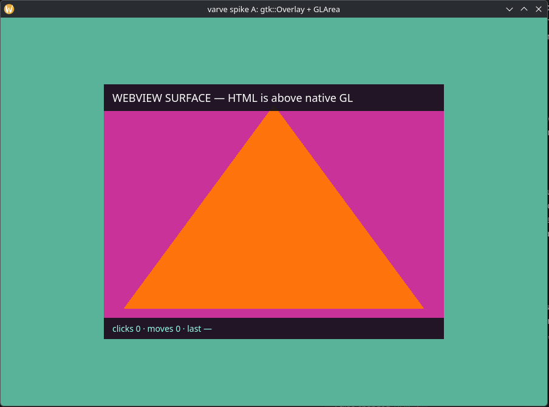
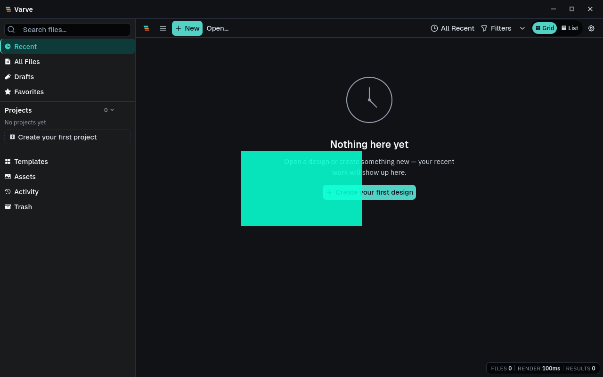

# Spike A — Wayland `gtk::Overlay` + `gtk::GLArea` (2026-10-16)

Evidence for ADR-0244's Linux presentation spike. Spike source:
[`spikes/wayland-overlay-glayer/`](../../spikes/wayland-overlay-glayer/)
(non-workspace crate). Verdict lines are at the bottom and are the only part
ADR-0244 cites.

## Question

ADR-0244, "Why not the alternatives":

> a `gtk::Overlay` + `gtk::GLArea` spike (wry ships `examples/gtk_opengl.rs` …)
> to establish whether a native surface composites above or below a
> `WebKitWebView` on Wayland, and whether input routing survives.

## Environment (all measured, none assumed)

| Component | Version |
|---|---|
| OS / session | CachyOS, KDE Plasma, native Wayland (`WAYLAND_DISPLAY=wayland-0`) |
| GPU / driver | AMD Ryzen 3 5300U iGPU (Lucienne), Mesa RADV |
| GTK | 3.24.52 |
| WebKitGTK | 2.54.1 (`webkit2gtk-4.1` via pkg-config) |
| Crates | `gtk 0.18`, `webkit2gtk 2.0.2` (the exact pair wry 0.57 pins), `glow 0.16`, `libloading 0.8` |
| GL context | `gtk::GLArea` created a **GL 4.6** context on the first try |
| Spike commits | layout mirrors wry `examples/gtk_opengl.rs`: GLArea as Overlay main child, webview in a `gtk::Fixed` overlay child, `set_background_color(rgba(0,0,0,0))`, `has_alpha(true)` |

## Result 1 — compositing: PASS (native Wayland, OS-level capture)

Captures were made by KDE `spectacle` while the spike ran, not in-process
screenshots — browser-internal capture cannot see native layers. The committed
PNG files are crops of the spike window from those OS-level captures; their
pixels were not retouched.

- The **native GLArea** fills the window with its animated colour sweep and the
  fixed orange triangle (`wayland-native-initial-window.png`,
  `wayland-native-later-frame-window.png`).
- The **webview's opaque header** ("WEBVIEW SURFACE — HTML is above native GL")
  and **footer** (DOM counters) render **above** the GL pixels.
- The webview's **transparent centre** shows the GL content **through it** — the
  triangle continues seamlessly across the webview boundary. Alpha blending of
  the WebKitGTK surface over the native GL surface works on native Wayland.

**Caveat found by the captures, not by reading code:** in the first capture the
webview's transparent region shows a *different GL frame* (magenta sweep phase)
than the surrounding area (the first, teal frame). GTK's damage handling
redrew only the webview's rectangle at a later frame-clock tick, and the GLArea
redrew inside that clip. For the spike's animated hue this is a visible
mismatch; for Varve's actual use (a stable document frame under an overlay UI)
the equivalent requirement is a discipline: when the webview recomposites, the
native layer must be invalidated through the same frame clock so the two
surfaces cannot disagree. This is a scheduling rule for an integration, not a
blocker — recorded so it cannot be rediscovered as a bug later.

## Result 2 — input: no abort (three runs), delivery partially verified

Wry #1808 reports that `tauri-runtime-wry` 2.11.2 assumed
`webview → GtkBox → GtkWindow` and unwrapped the ancestor downcast inside a
button-press handler, aborting when an overlay changed that chain. Varve's
lockfile pins `tauri-runtime-wry` 2.12.1. Its checked-in crate source keeps the
same fixed-depth lookup but returns `None` for a failed downcast, so the exact
reported abort is not present in the pinned source. An inserted wrapper can
still make undecorated edge-resize handling return early. This standalone
spike excludes `tauri-runtime-wry`; only an integrated run can establish the
actual behavior.

| Evidence | Result |
|---|---|
| Full auto sequence (3 webview clicks, 1 GLArea click, resize, 4th click) on native Wayland | **Completed, exit 0, no abort, three consecutive runs** (`wayland-native-run.txt`) |
| Same on XWayland (`GDK_BACKEND=x11`, where `gdk_test_simulate_button` works via XTest) | **Completed, exit 0, no abort** (`xwayland-run.txt`) |
| Synthesized events accepted by GDK | `true` for every click on both backends |
| Events reaching the web page | `pointermove` counters increment through the full stack (`moves: 7` on XWayland) — WebKit's input pipeline runs under the overlay stack |
| DOM `click` counters | **Never incremented** from synthesized events, on any run |
| GTK widget-level `button-press-event` handlers | Never fired from synthesized events, on any run |
| Resize | Window resized to 1120×760; GLArea reallocated; webview recentred via the wry-style `move_` dance (`xwayland-post-resize-window.png`) |

**Reading:** the crash class is absent — no click path aborts or corrupts
anything. But `gdk_test_simulate_button`-driven clicks are **not** sufficient
evidence of real-click routing into DOM `click` handlers: WebKit did not
synthesize a DOM click from any faked event stream, and the widget-signal
handlers did not observe the faked presses. On native Wayland the GDK test
utility refuses outright (it is XTest-backed). **Synthetic input evidence is
therefore classified inconclusive**, and the honest statement is narrower:

- Verified: the widget stack (Overlay → Fixed → WebKitWebView) does not break
  GDK event delivery to the web process, and nothing aborts.
- Not verified by automation: that a **real** pointer click produces a DOM
  click through this stack on native Wayland.
- Remaining step: `./wayland-overlay-glayer --interactive` on a real session —
  the DOM counters in the footer are the acceptance signal — plus a
  wry-integrated spike (`build_gtk` path) before any Tauri-level claim. That
  must verify real input, window resize behavior, and whether a custom widget
  ancestry affects undecorated edge-resize handling.

## Result 3 — what this spike does not claim

- It proves **GL-rasterizer pixels compositing under WebKitGTK**. It does not
  prove wgpu-Vulkan frames inside a GLArea (that is a texture-sharing question
  adjacent to spike B) — the GL here is a plain desktop-GL context via
  `libGL`/`libEGL` entry points, the same loader strategy as wry's example.
- It does not validate the Tauri runtime path (`tauri-runtime-wry` handlers,
  decorated/undecorated resize logic). A positive integration decision still
  requires that spike. Issue #1808 is open against 2.11.2; Varve's pinned
  2.12.1 source no longer unwraps the failed downcast, but its fixed-depth
  lookup can still disable resize handling after reparenting.
- Screenshots were taken with KDE `spectacle` (compositor capture); WebKitGTK
  content in them is the real web process output, GL content is the real GL
  context — neither layer is simulated. The checked-in crops retain the whole
  spike window and omit unrelated desktop content.

## Product and website claim check

The current product and docs pages were checked against this spike and the
threading audit. They already say that desktop GPU raster/effect work is
offscreen, Canvas2D remains the display path, the public GitHub Pages demo
cannot use shared-memory WASM, and preview resolution can be reduced under
frame pressure. No marketing claim currently treats this GLArea compositing
test as a delivered Varve feature, so changing marketing copy would overstate
the evidence rather than improve its accuracy.

## Follow-up — orderly shutdown (2026-10-17)

The auto-readback path now closes its GTK window after collecting the webview
summary instead of calling `process::exit`. This runs the normal GLArea
`unrealize` handler, which deletes its GL program and VAO. Shader setup also
checks compile and link status and cleans up partial objects on failure; it
reports an error instead of panicking. The isolated spike passes
`cargo fmt --check` and `cargo check --locked`.

Both backend lifecycle runs exited successfully and logged
`[gl] unrealized; GL resources deleted`:

- [XWayland follow-up log](../screenshots/wayland-spike/clean-shutdown-xwayland-2026-10-17.txt):
  GL 4.6 rendered; GDK accepted synthesized clicks, but the web page's click
  count stayed zero. This remains inconclusive for real pointer routing.
- [Native Wayland follow-up log](../screenshots/wayland-spike/clean-shutdown-wayland-2026-10-17.txt):
  GL 4.6 rendered; GDK rejected synthesized clicks as expected. This is
  lifecycle evidence only, not input evidence.

These reruns qualify shutdown and resource cleanup in the standalone spike.
They do not expand the original compositing verdict or validate Tauri/Wry.

## Follow-up — actual Tauri/Wry host, diagnostic layer only (2026-10-17)

An opt-in probe was then attached to Varve's real Tauri window with
`VARVE_NATIVE_PRESENTATION_SPIKE=1`. Its first layout reparented the existing
Wry `WebKitWebView` into a `GtkOverlay` and placed an alpha-enabled `GtkGLArea`
above it. The probe draws a centered teal marker; it does not consume document
IR or replace the document canvas. The capture below records that initial
layout, where the marker visibly covers home-screen content. It is diagnostic
evidence of host compositing, and also evidence that this layer order is not
acceptable for the app.

| Check | Evidence | Result |
|---|---|---|
| Actual Wry host can create the GL context | Tauri log: `GLArea context realized in Tauri window` | **Pass** |
| Native alpha layer composites over live Varve home UI | OS-level active-window capture above | **Pass** — host compositing only; the diagnostic marker obscures UI |
| Overlay GTK pass-through property | Tauri log: `GLArea overlay pass-through property: true` | **Pass** — property state only, for the superseded top-layer layout |
| Input reaches the WebView and UI responds | Earlier virtual-pointer attempts produced GTK toplevel button events but no observable home-screen action. The first widget signal tracer omitted GTK's button event mask; it cannot support a conclusion about WebView delivery. | **Inconclusive** — pointer injection is not a physical-pointer acceptance run |
| Document frame is presented by the native layer | Probe renders only its marker; no document IR transport or canvas replay suppression | **Not tested** |

The probe preserves `WebView → GtkOverlay → GtkWindow`, matching the pinned
Wry runtime's expected ancestor depth. After visual inspection showed that the
GL marker covered home-screen content, the current probe source was changed to
make the `GLArea` the base child and the WebView the foreground child. That
under-WebView layout has not yet been relaunched or visually validated; the
capture and pass-through-property row above refer to the earlier, superseded
top-layer arrangement. The revised ancestry still avoids the known
fixed-depth downcast abort mechanism in the 2.12.1 source, but resize handling,
pointer capture, keyboard focus, and full editor interaction remain unverified.
The detached Tauri probe module is gated by an environment variable and should
remain diagnostic until the revised layout and real editor interactions pass.

The visibility constraint is now explicit: GTK documents that
`GtkOverlay.add_overlay` stacks an overlay child above the main child, while
the main child is drawn at the bottom ([GTK 3.24 API](https://docs.gtk.org/gtk3/method.Overlay.add_overlay.html),
[stack ordering](https://docs.gtk.org/gtk3/method.Overlay.reorder_overlay.html)).
WebKitGTK's transparent background is only visible where the page itself does
not paint an opaque background ([WebKitGTK API](https://webkitgtk.org/reference/webkit2gtk/stable/method.WebView.set_background_color.html)).
Varve's desktop `body` currently paints `var(--color-surface-app)` in
`apps/desktop/src/global.css`, so the underlay is expected to be hidden behind
ordinary app chrome and the home screen. A useful integration visual must open
an editor and verify the canvas region, frame bounds, and transparent
surrounding areas; a hidden marker on the home screen is not evidence that the
native frame is either correct or broken.

The opt-in widget tracer now adds `BUTTON_PRESS_MASK` before attaching its
WebView and GLArea signal handlers. The corrected build launched, but the
follow-up uinput probe could not correlate pointer movement with XQueryPointer
on this Wayland session and was stopped before a button attempt. The corrected
signal handlers therefore still have no input result; earlier missing signal
logs remain non-evidence for delivery.

## Verdict

| ADR-0244 spike question | Verdict |
|---|---|
| Does a native surface composite below a `WebKitWebView` on Wayland? | **PASS** — GL below, HTML above, transparency verified on native Wayland (and XWayland), OS-level captures committed |
| Does input routing survive? | **Inconclusive** — the standalone has no Wry handlers; earlier virtual-pointer attempts at the Tauri host observed toplevel events but no visible UI action. The corrected widget tracer launched, but the follow-up pointer injector stalled before a button attempt. Real-pointer routing and editor interactions remain unverified. |
| Frame-clock consistency under partial damage | New caveat, documented above — an integration must keep the native layer and webview recomposites on one frame clock |

Verdict for ADR-0244: the Linux "unproven mechanism" is now **proven at the
compositing level**; the open work for native presentation on Linux is an
integration spike (wry/`tauri-runtime-wry`), a frame-clock discipline, and
manual input verification — not a search for a mechanism.
